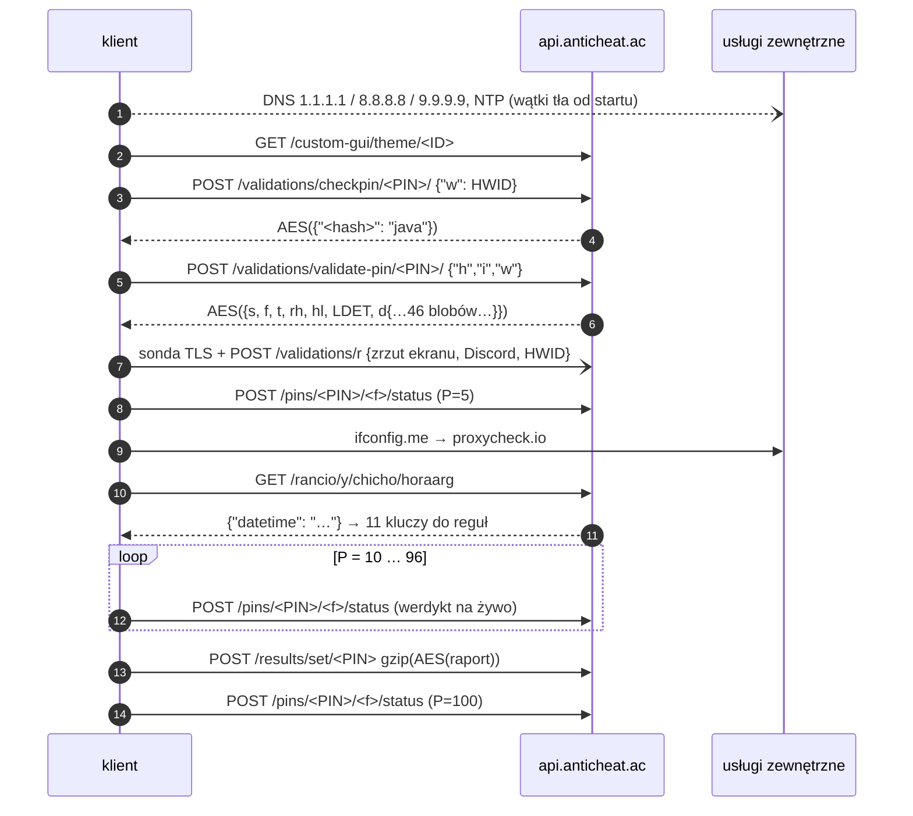
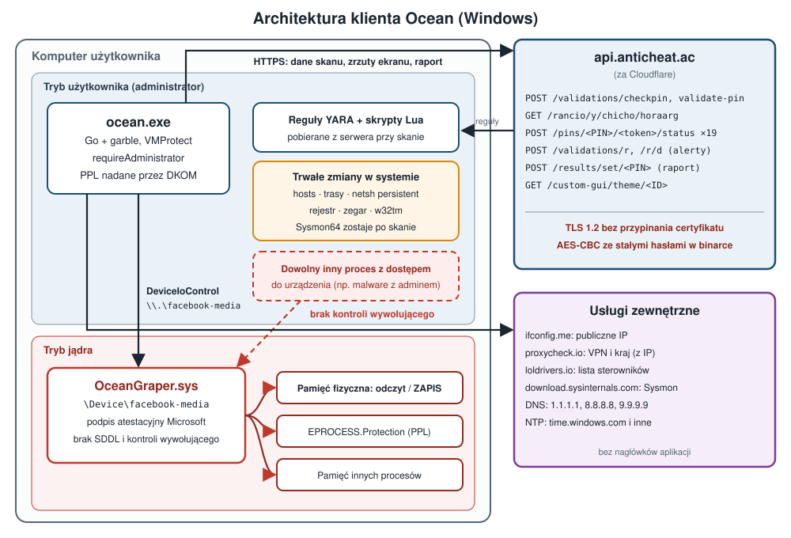
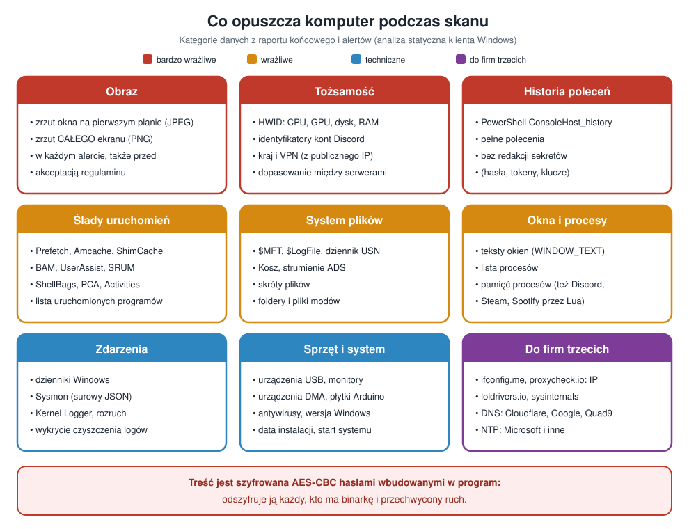

# Zegar, sinus i „MAQUINADEARMADO”, czyli jak klient anty-cheat zabezpiecza swoje API

**Autor:** Wojciech Krzysik<br>
**Data:** listopad 2026<br>
**Temat:** analiza statyczna klienta „Ocean Anti-Cheat” (`ocean.exe`, Windows x64, Go + VMProtect)<br>
**Analizowany produkt:** [Ocean Anti-Cheat](https://anticheat.ac)<br>
**Przykład sfabrykowanego skanu na stronie:** https://anticheat.ac/results/pin/X1P4J6F5 · wideo: https://youtu.be/3uhOqBqCfqg<br>
**English version:** [README_EN.md](README_EN.md)<br>
**Udział AI:** analiza i tekst powstały z pomocą narzędzi AI (szczegóły w rozdziale 22).

> **TL;DR**
> - Klient wysyła na serwer zrzut ekranu, identyfikatory kont Discord, historię PowerShella, ślady uruchamianych programów i wiele więcej.
> - API nie ma nagłówka `Authorization`, HMAC-a, klucza API ani pinningu certyfikatu.
> - Ochrona protokołu opiera się na trzech pomysłach:
>   - treść szyfrowana w formacie CryptoJS hasłami wbudowanymi w binarkę;
>   - „podpis” końcowego URL-a po przekierowaniach;
>   - klucz do reguł detekcji wyliczany z **zegara serwera** przez sumę miliona sinusów.
> - To zaciemnianie, nie kryptografia w ścisłym sensie. Działa tylko tak długo, jak długo nikt nie rozpakuje binarki.
> - Większe ryzyko dla użytkownika niż słabości protokołu to **podpisany sterownik jądra** z odczytem i zapisem dowolnej pamięci fizycznej bez kontroli wywołującego, modyfikacja `EPROCESS` oraz trwałe zmiany sieci, zegara i rejestru.
> - **Polityka prywatności** nie wspomina o żadnej z tych ingerencji i pomija kilkanaście kategorii zbieranych danych, mimo że strona pobierania twierdzi, że „lists every item”.
> - Dla graczy: **lista kontrolna** (rozdział 20), jak po skanie sprawdzić i cofnąć sterownik, Sysmon i zmiany w systemie.

---

## Spis treści

1. [Skąd ten tekst](#1-skąd-ten-tekst)
2. [Zanim cokolwiek przeczytamy: VMProtect i garble](#2-zanim-cokolwiek-przeczytamy-vmprotect-i-garble)
3. [Mapa ruchu: 16 kanałów](#3-mapa-ruchu-16-kanałów)
4. [Warstwa transportowa: TLS 1.2 i nic więcej](#4-warstwa-transportowa-tls-12-i-nic-więcej)
5. [Kim jesteś? PIN, HWID i skrót własnego pliku](#5-kim-jesteś-pin-hwid-i-skrót-własnego-pliku)
6. [Szyfrowanie treści: CryptoJS w Go](#6-szyfrowanie-treści-cryptojs-w-go)
7. [„Podpis” adresu: obrona przed przekierowaniem](#7-podpis-adresu-obrona-przed-przekierowaniem)
8. [Najciekawszy kawałek: klucz z zegara i miliona sinusów](#8-najciekawszy-kawałek-klucz-z-zegara-i-miliona-sinusów)
9. [Co przysłał serwer](#9-co-przysłał-serwer)
10. [Postęp na żywo, czyli werdykt, zanim skan się skończy](#10-postęp-na-żywo-czyli-werdykt-zanim-skan-się-skończy)
11. [Raport końcowy: 76 kluczy, których nie przeczytasz bez soli](#11-raport-końcowy-76-kluczy-których-nie-przeczytasz-bez-soli)
12. [Alarmy, sonda TLS i strażnik czasu](#12-alarmy-sonda-tls-i-strażnik-czasu)
13. [Jakie dane opuszczają komputer](#13-jakie-dane-opuszczają-komputer)
14. [Na czym to wszystko stoi: ocena modelu zaufania](#14-na-czym-to-wszystko-stoi-ocena-modelu-zaufania)
15. [Zagrożenia dla użytkownika: sterownik, jądro i trwałe zmiany w systemie](#15-zagrożenia-dla-użytkownika-sterownik-jądro-i-trwałe-zmiany-w-systemie)
16. [Polityka prywatności kontra kod: co się zgadza, a co nie](#16-polityka-prywatności-kontra-kod-co-się-zgadza-a-co-nie)
17. [Galeria błędów](#17-galeria-błędów)
18. [Hiszpańskojęzyczne smaczki](#18-hiszpańskojęzyczne-smaczki)
19. [Ewolucja programu](#19-ewolucja-programu)
20. [Lista kontrolna dla graczy: co sprawdzić po skanie](#20-lista-kontrolna-dla-graczy-co-sprawdzić-po-skanie)
21. [Rekomendacje dla producenta](#21-rekomendacje-dla-producenta)
22. [Warsztat: jak to zostało odczytane](#22-warsztat-jak-to-zostało-odczytane)
23. [Podsumowanie](#23-podsumowanie)

> [!WARNING]
> **Zastrzeżenie.** Ten tekst jest wyłącznie analizą techniczną prowadzoną w celach **badawczych i edukacyjnych**.
> - Opisuje wyniki analizy jednej wersji programu i wyraża opinię autora. Nie jest opinią prawną ani zarzutem popełnienia przestępstwa.
> - Analiza była statyczna. Program nie był uruchamiany w systemie, a z jego serwerami nie łączono się z analizowanego środowiska.
> - Wartości sekretów (hasła, sole, klucze) zostały celowo pominięte. Artykuł nie jest instrukcją omijania zabezpieczeń, fałszowania skanów ani wykorzystywania opisanych podatności. Nie używaj tych informacji do takich celów.
> - Fragmenty kodu oznaczone jako uproszczone są ilustracją, a nie dosłownym kodem programu. Nazwy funkcji to rekonstrukcja autora.
> - Producent mógł zmienić program po dacie analizy. Autor nie ponosi odpowiedzialności za skutki wykorzystania tych informacji.

---

## 1. Skąd ten tekst

„Skanery” anty-cheat dla graczy stały się osobną kategorią oprogramowania. Społeczność serwera Minecrafta czy FiveM prosi gracza o pobranie programu i wpisanie PIN-u. Program przez kilkanaście minut przegląda komputer, a moderator dostaje na stronie raport „legit / suspicious / cheating”.

Taki program działa z uprawnieniami administratora, ładuje własny sterownik jądra i czyta prawie wszystko. Ciekawsze od samego skanowania jest dla mnie pytanie, **jak rozmawia ze swoim serwerem**:
- jak chroni zebrane dane przed podglądem;
- jak serwer upewnia się, że raport nie został podrobiony.

Ten artykuł opisuje odpowiedź na podstawie pełnej, **wyłącznie statycznej** analizy klienta Windows.

Zasady, których się trzymałem:
- **Brak uruchomienia próbki na systemie.** Rozpakowanie odbyło się w emulatorze CPU (Unicorn), w którym każde wywołanie Windows API obsługiwała atrapa w Pythonie. Sieć była zablokowana.
- **Ukryte sekrety.** Wszystkie hasła, sole i klucze zastąpiłem w tekście znacznikiem `<REDACTED>`. Pokazuję mechanizmy, nie gotowe narzędzie do fałszowania raportów.
- **Nazwy funkcji to rekonstrukcja.** Kompilator garble zamienia identyfikatory na skróty, np. `SRXdjXFy64e0`. Nazwy w stylu `AuthenticateWithAPI` nadałem na podstawie zachowania kodu.

---

## 2. Zanim cokolwiek przeczytamy: VMProtect i garble

Binarka jest zabezpieczona podwójnie.

**Warstwa 1: VMProtect.**
- **Pakowanie i kontrole startowe.** Plik jest spakowany, a loader zawiera kontrole anty-debug: `ProcessDebugPort`, `ThreadHideFromDebugger`, `NtClose(0xDEADC0DE)` oraz pułapkę single-step obsługiwaną przez własny handler SEH.
- **Ukrywanie importów.** Wywołania API zamienione są na `call` do „thunków”, które wyliczają adres funkcji w locie.

Emulator przeszedł cały loader i zrzucił obraz w chwili skoku do OEP. Każde z 1 687 miejsc wywołań przez thunki rozwiązałem osobną mikro-emulacją, żeby ustalić, które API ukrywa.

**Warstwa 2: garble (Go).**
- **Identyfikatory.** Nazwy pakietów i funkcji są haszowane.
- **Literały.** Każdy literał tekstowy jest zaszyfrowany i składany w czasie działania przez wygenerowaną maszynę stanów.

Tak wygląda zdekompilowany fragment funkcji tworzącej klienta HTTP:

```c
// app_winapi_common.DialHTTPConnection (fragment, Ghidra po deobfuskacji)
puVar6 = runtime_newobject(&type_net_Dialer);
*puVar6     = 15000000000;          // Dialer.Timeout   = 15 s
puVar6[8]   = 30000000000;          // Dialer.KeepAlive = 30 s
lVar7 = runtime_makeslice(&type_uint8, 0, 0xd);
bVar12 = 7;                         // stan początkowy maszyny literału
while (bVar12 != 4) {               // 4 = stan końcowy
    if (bVar12 == 0) {              // dopisz 2 bajty: ('T' - key) ^ 199
        ...
        bVar12 = 5;
    } else if (bVar12 == 1) {       // „odkręcenie”: b[i] += i ^ k
        for (i = 0; i < len; i++) buf[i] += (u8)i ^ bVar10;
        bVar12 = 4;
    } else if (bVar12 == 2) {       // dopisz bajt 0x2a
        ...
        bVar12 = 0;
    }
    ...
}
```

Takich bloków są tysiące. Odczytałem je na dwa sposoby:
- emulacją CPU **samego bloku dekodującego**, od miejsca przygotowania danych do wywołania konwertera;
- emulacją tablic skoków `switch` tam, gdzie garble zamienił literał w maszynę stanów.

W ten sposób odzyskałem 91,9% z 14 116 literałów jako czysty tekst. Dopiero wtedy kod da się czytać.

---

## 3. Mapa ruchu: 16 kanałów

Przejrzałem graf wywołań pod kątem wszystkich odwołań do `net/http`, `net.Dial*`, resolvera DNS i `crypto/tls`. Wyszło dokładnie 16 kanałów sieciowych. Program **niczego nie nasłuchuje**.

| # | Kanał | Adres | Po co |
|---|---|---|---|
| 1 | motyw GUI | `GET api.anticheat.ac/custom-gui/theme/<ID>` | wygląd okna per społeczność |
| 2 | wstępny PIN | `POST …/validations/checkpin/<PIN>/` | czy PIN istnieje, dla jakiej gry |
| 3 | **uwierzytelnienie** | `POST …/validations/validate-pin/<PIN>/` | token sesji, konfiguracja, zaszyfrowane reguły |
| 4 | alert startu | `POST …/validations/r` | „skan ruszył” + zrzut ekranu |
| 5 | postęp | `POST …/pins/<PIN>/<token>/status` | 19 razy: 5 → 100% |
| 6–7 | IP i VPN | `ifconfig.me/ip`, `proxycheck.io/v2/<IP>?vpn=1&asn=1` | kraj, VPN |
| 8 | **czas serwera** | `GET …/rancio/y/chicho/horaarg` | ziarno kluczy reguł |
| 9 | LOLDrivers | `loldrivers.io/api/drivers.json` | skróty podatnych sterowników |
| 10 | Sysmon | `download.sysinternals.com/files/Sysmon.zip` | instalacja lub naprawa Sysmon |
| 11 | **raport** | `POST …/results/set/<PIN>` | wynik końcowy |
| 12 | alerty integralności | `POST …/validations/r/d` | VM, hooki, MITM, timeout |
| 13 | sonda TLS | handshake z `anticheat.ac:443` | wykrycie przechwycenia TLS |
| 14 | DNS publiczny | `1.1.1.1`, `8.8.8.8`, `9.9.9.9` | wykrycie blokady w `hosts` lub DNS |
| 15 | DNS systemowy | resolver Windows, co ~5 s | porównanie z regułami zapory |
| 16 | NTP | `time.windows.com` i inne | **ustawienie zegara systemowego** |

Przebieg jednej sesji w uproszczeniu:



Cały obraz, łącznie z tym, co dzieje się w jądrze (pkt 15):



---

## 4. Warstwa transportowa: TLS 1.2 i nic więcej

Większość zapytań przechodzi przez jedną funkcję budującą klienta HTTP. Jej zrekonstruowany odpowiednik w Go:

```go
func DialHTTPConnection(timeout time.Duration) *http.Client {
    d := &net.Dialer{Timeout: 15 * time.Second, KeepAlive: 30 * time.Second}
    tr := &http.Transport{
        DialContext: func(ctx context.Context, _, addr string) (net.Conn, error) {
            return d.DialContext(ctx, "tcp4", addr)     // tylko IPv4
        },
        Proxy: nil,                                     // ignoruje proxy systemowe i HTTP(S)_PROXY
        TLSClientConfig: &tls.Config{
            MinVersion: tls.VersionTLS12,
            MaxVersion: tls.VersionTLS12,               // dokładnie TLS 1.2
            NextProtos: []string{"http/1.1"},           // bez HTTP/2
            // brak InsecureSkipVerify, brak VerifyPeerCertificate → brak pinningu
        },
        TLSHandshakeTimeout:   15 * time.Second,
        IdleConnTimeout:       90 * time.Second,
        ExpectContinueTimeout: 1 * time.Second,
    }
    return &http.Client{Transport: tr, Timeout: timeout}
}
```

Kilka obserwacji:

- **Brak proxy i tylko IPv4.** Utrudnia to proste przekierowanie ruchu przez lokalne proxy do analizy. Klient tego proxy po prostu nie widzi.
- **Brak pinningu certyfikatu.** Zaufany jest każdy certyfikat z systemowego magazynu CA. Autorzy zapewne o tym wiedzieli, bo dodali osobną **sondę TLS** (pkt 12).
- **Brak ponowień.** Każde zapytanie idzie raz. Raport końcowy nie ma nawet globalnego timeoutu.
- **Wszędzie ten sam User-Agent: `MAQUINADEARMADO`.** Po hiszpańsku *máquina de armado* to dosłownie „maszyna do składania” (więcej takich smaczków w pkt 18). To nie jest sekret: wysyłany jest jawnie z każdym zapytaniem do API.

Ciekawostka: trzy zapytania (`validate-pin`, LOLDrivers, Sysmon) używają domyślnego klienta Go, który **respektuje** zmienne `HTTPS_PROXY`. Ta niekonsekwencja dotyczy akurat najważniejszego zapytania, czyli uwierzytelnienia.

---

## 5. Kim jesteś? PIN, HWID i skrót własnego pliku

Klient przedstawia się serwerowi trzema wartościami.

### 5.1 PIN zaszyty w nazwie pliku

PIN ma 8 znaków i zwykle jest wpisany w nazwę pobranego pliku, np. `Ocean-L3V0Z2E0.exe`. Program może też wziąć go ze schowka albo z klawiatury. Fragment po `-` służy też do pobrania motywu GUI danej społeczności.

### 5.2 HWID

HWID to 42 znaki hex wyliczane z kilku parametrów sprzętu:

```go
func ComputeHWID() string {
    cpu  := strip(wmi("SELECT Name FROM Win32_Processor"))           // spacje usunięte
    gpu  := strip(wmi("SELECT Caption FROM Win32_VideoController"))  // albo EnumDisplayDevicesW
    disk := strip(wmi("SELECT Model FROM Win32_DiskDrive WHERE Index = 0"))
    ramGB := float64(totalPhysicalMemory) / (1 << 30)
    slots := memorySlots()        // rejestr SystemMemorySlots lub WMI
    speed := firstModuleSpeed()   // SMBIOS przez SetupAPI lub WMI

    data := fmt.Sprintf("%s%s%s%.2f%d%d", cpu, gpu, disk, ramGB, slots, speed)
    sum  := sha256.Sum256([]byte(data + "<REDACTED: 78-znakowa sól>"))
    return hex.EncodeToString(sum[:])[:42]
}
```

Wady tej konstrukcji:
- **Słaba unikalność.** Dwa identyczne komputery z tej samej serii dają ten sam HWID.
- **Łatwa zmiana.** Wymiana dysku albo karty graficznej daje nowy HWID.

W kodzie jest też drobny błąd: gdy odczyt modelu dysku się nie uda, kod nadpisuje zmienną **GPU** zamiast dysku.

### 5.3 Skrót własnego pliku

Przy uwierzytelnieniu klient wysyła trzy pola:

```json
{"h": "<sha256 własnego .exe>", "i": "<md5(PIN)>", "w": "<HWID>"}
```

Pole `h` pozwala serwerowi odrzucić zmodyfikowaną binarkę. Działa to jednak tylko wobec kogoś, kto zmienia plik i nie zmienia wysyłanej wartości. Klient sam liczy i sam deklaruje ten skrót, więc to raczej kontrola wersji niż prawdziwa atestacja.

---

## 6. Szyfrowanie treści: CryptoJS w Go

Prawie każda treść, w obie strony, jest szyfrowana jedną funkcją. Odtworzyłem ją z dezasemblacji:

```go
// format zgodny z CryptoJS.AES.encrypt(text, pass) i `openssl enc -aes-256-cbc -md md5 -a`
func encryptString(plain, password string) string {
    salt := make([]byte, 8)
    io.ReadFull(rand.Reader, salt)

    // OpenSSL EVP_BytesToKey z MD5: D_i = MD5(D_{i-1} || password || salt)
    var d, prev []byte
    for len(d) < 48 {
        h := md5.Sum(append(append(prev, password...), salt...))
        prev = h[:]
        d = append(d, prev...)
    }
    key, iv := d[:32], d[32:48]

    block, _ := aes.NewCipher(key)
    ct := pkcs7Pad([]byte(plain), 16)
    cipher.NewCBCEncrypter(block, iv).CryptBlocks(ct, ct)
    return base64.StdEncoding.EncodeToString(append(append([]byte("Salted__"), salt...), ct...))
}
```

Zaszyfrowane odpowiedzi serwera zaczynają się od `U2FsdGVkX1`, czyli `Salted__` w base64. To od razu zdradza format.

Ciekawsze od algorytmu są **hasła**:

| Treść | Hasło |
|---|---|
| odpowiedź `checkpin` | stała 32-cyfrowa `<REDACTED>` + PIN |
| odpowiedź `validate-pin` | `hex(sha256(PIN + "<REDACTED>"))` |
| statusy postępu | `hex(sha256(token_sesji + PIN))` |
| alerty `/validations/r` | stała `<REDACTED>`, udająca nazwę biblioteki Go z GitHuba |
| raport końcowy | inna stała `<REDACTED>`, też udająca nazwę biblioteki Go |
| reguły detekcji (`d`) | klucz z zegara serwera (pkt 8) |

Hasła do alertów i raportu udają ścieżki importu bibliotek Go w stylu `github.com/autor/pakiet`. Ktoś przeglądający `strings` binarki uzna je za zwykłe pozostałości kompilacji. To sprytny kamuflaż.

Konsekwencja jest jednak poważna: **każdy, kto ma binarkę, odszyfruje alerty i raport**, bo hasła są stałe. Bez ruchu sieciowego się nie obejdzie, ale żaden sekret serwera nie jest potrzebny. Z całego zestawu tylko statusy postępu zależą od tajemnicy sesji, czyli tokenu `f` z odpowiedzi serwera.

AES-CBC bez MAC-a nie chroni też integralności. Zmodyfikowany szyfrogram odszyfruje się do śmieci zamiast zostać odrzucony. Serwer może co najwyżej zauważyć, że JSON się nie parsuje.

---

## 7. „Podpis” adresu: obrona przed przekierowaniem

Po dwóch zapytaniach (`validate-pin` i `/horaarg`) klient sprawdza, **dokąd naprawdę trafił**, czyli końcowy URL po ewentualnych przekierowaniach HTTP:

```go
func checkFinalURL(resp *http.Response, cut int, secret, want string, code int) {
    if resp.Request == nil || resp.Request.URL == nil {
        os.Exit(224)
    }
    parts := strings.Split(resp.Request.URL.String(), "/")
    if len(parts) < 2 {
        os.Exit(225)
    }
    base := strings.Join(parts[:len(parts)-cut], "/")   // validate-pin: odcina "<PIN>/"
    sum := sha256.Sum256([]byte(base + "/" + secret))
    if hex.EncodeToString(sum[:]) != want {
        os.Exit(code)                                   // 226 albo 16
    }
}
```

Przeliczyłem oba skróty: zgadzają się dla `https://api.anticheat.ac/validations/validate-pin` i `https://api.anticheat.ac/rancio/y/chicho/horaarg`.

To, nawiasem mówiąc, rozstrzygnęło spór o ścieżkę. Wcześniejsza wersja Linux sugerowała `/hora`, a skrót potwierdza `/horaarg`.

Ocena:
- **Co chroni:** wykrywa przekierowanie (301/302) na inny serwer, np. przez lokalny proxy, który odsyła na własną domenę.
- **Czego nie chroni:** nie pomaga, jeśli atakujący podstawi odpowiedź pod **tym samym** adresem, np. przez MITM z własnym zaufanym CA. Wtedy URL się zgadza.
- **Charakter mechanizmu:** sekret dołączany do skrótu jest w binarce, więc to raczej „czy URL jest dokładnie tym jednym napisem” w postaci, której nie widać w `strings`.

---

## 8. Najciekawszy kawałek: klucz z zegara i miliona sinusów

Odpowiedź `validate-pin` zawiera obiekt `d` z ponad 40 zaszyfrowanymi blobami:
- skompilowane reguły YARA i YARA-X;
- listy plików;
- offsety struktur JVM;
- sygnatury sprzętu DMA.

Klucz do nich **nie przychodzi w tej odpowiedzi**. Klient zdobywa go tak:

1. Wysyła `GET /rancio/y/chicho/horaarg` (*hora* po hiszpańsku znaczy „godzina”).
2. Dostaje jawny JSON `{"datetime": "2026-11-02T16:06:…-03:00"}`.
3. Dla przesunięć od −5 do +5 minut tworzy 11 napisów w formacie `RRRR:MM:DDgg:mm`.
4. Z każdego napisu wylicza klucz tak:

```go
func deriveKey(stamp string) string {          // np. "2026:11:0216:06"
    p := strings.Split(stamp, ":")
    year, month := atof(p[0]), atof(p[1])
    ddhh, minute := atof(p[2]), atof(p[3])     // "0216" → 216

    x := minute + year*60 + month/ddhh

    var sum float64
    for k := 1; k <= 999999; k++ {             // milion wyrazów szeregu
        sum += math.Sin(float64(k)*x) / math.Sqrt(float64(k))
    }
    return fmt.Sprintf("%.6f", sum)            // klucz = liczba jako tekst z 6 miejscami po przecinku
}
```

5. Każdym z 11 kluczy próbuje odszyfrować kolejne bloby. Wynik akceptuje, gdy jest poprawnym JSON-em albo zawiera słowo `import` lub `YARA`.

Pomysł jest oryginalny. Szereg `Σ sin(kx)/√k` jest warunkowo zbieżny i ma wartości trudne do przewidzenia „na oko”, a milion iteracji kosztuje kilkanaście milisekund. Serwer może zmieniać klucz co minutę bez wysyłania go jawnie. Okno ±5 minut daje tolerancję na rozjechane zegary. To pewnie dlatego klient **przestawia zegar systemowy przez NTP** (kanał 16), co samo w sobie jest dość inwazyjne.

Słabość widać jednak od razu. **Entropia klucza to jedna minuta czasu serwera.** Doba ma 1 440 minut, a stref czasowych jest kilkadziesiąt. Wystarczy przybliżony czas przechwycenia odpowiedzi, by sprawdzić wszystkich kandydatów w ułamku sekundy. W testowym przechwyceniu ruchu (odtworzonym poza programem) poprawny klucz znalazł się po **259 próbach**. Przy okazji wyszło, że zegar serwera chodzi w strefie **UTC−3**, co pasuje do hiszpańskich komunikatów w kodzie.

Ten „klucz” nie jest więc sekretem. To znacznik czasu przepuszczony przez funkcję deterministyczną, publicznie zapisaną w binarce. Chroni treść reguł przed przypadkowym podglądem, ale nie przed analitykiem.

---

## 9. Co przysłał serwer

Analiza binarki mówi, co klient **potrafi** zrobić. Odpowiedź serwera pokazuje, co zrobić mu **każe**.

Sekwencja zapytań klienta została odtworzona poza programem, bez uruchamiania próbki: motyw GUI, `checkpin`, `validate-pin`, DNS i NTP. Przebieg zatrzymał się przed `/horaarg`, statusami i raportem, więc żaden raport ani zrzut ekranu nie został wysłany. Wszystko poniżej odszyfrowałem i przeanalizowałem offline, bez uruchamiania kodu z serwera.

### 9.1 Paczka 4,5 MB

Odpowiedź `validate-pin` miała **4,5 MB** i w całości była zaszyfrowana (CryptoJS, pkt 6). Po odszyfrowaniu zawierała:

| Pole | Co przyszło | Znaczenie |
|---|---|---|
| `s`, `t` | `true`, `"java"` | sukces, profil Minecraft/Java |
| `f`, `rh` | 64 i 16 znaków hex | token sesji i sól kluczy raportu (wartości pomijam) |
| `l`, `ru`, `jajaae` | `"False"`, `"false"`, `"false"` | moduły niestandardowe, skan klas cheatów i skan pamięci JVM **wyłączone** dla tego PIN-u |
| `cs`, `sus` | `"eselmesatraptoloculopatra"`, `"nopi nopi"` | zamiast szyfrogramu reguł zwykłe żarty po hiszpańsku. Nieużywane, bo `l != "True"` |
| `hl` | 9 skrótów SHA-256 | „zakazane” nazwy usług Windows, haszowane z 275-bajtową stałą |
| `LDET` | 32 kB | 4 skrypty Lua (pkt 9.3) |
| `d` | **44 bloby** | reguły i konfiguracje modułów (pkt 9.2) |
| `SysmonExpected` | `false` | **pole, którego analizowana binarka w ogóle nie zna** |

### 9.2 44 bloby: YARA z zatartymi wartościami

Klucz do blobów odzyskałem metodą z pkt 8: wystarczyło 259 kandydatów na „minutę serwera”. Jeden klucz otworzył wszystkie 44 bloby:
- **17 zestawów** skompilowanych reguł YARA (format libyara);
- **13 zestawów** YARA-X (serializowane `Rules`);
- **14 konfiguracji JSON**.

Serwer stosuje tu własne zaciemnianie:
- **Nazwy reguł i kluczy JSON** to losowe 20-literowe ciągi liter. Nazwy detekcji nie zdradzają, czego dotyczą.
- **Wartości w konfiguracjach** często są wypełniaczami `AAAA…` lub `aaaa…` różnej długości. Nie wiadomo, czy to maska nakładana per klient, czy celowo zatarte dane.
- **Literały w regułach** przetrwały kompilację. To z nich wiadomo, czego szukają reguły: domeny i loadery cheatów, klasy w rodzaju `autoclicker.class` czy `aimassist.class`, sygnatury packerów (Themida, VMProtect, Enigma), modele monitorów i karty przechwytujące używane w sprzęcie DMA, płytki typu Arduino (sprzętowe makra), ścieżki EFI/GRUB (wykrywanie dual-bootu).

Literały zawierają także ścieżki PDB z nazwami kont autorów różnych narzędzi. Tych danych osób trzecich tu nie przytaczam.

### 9.3 Lua po Prometheusie

Pole `LDET` to base64 → gzip → JSON z czterema skompilowanymi skryptami **Lua 5.4**. Bytecode zachował informacje debug, a nazwy chunków wyglądają jak `@/tmp/mig_….lua`, czyli ślady środowiska budowania po stronie serwera.

Skrypty przeszły przez dwa obfuskatory:
- **Prometheus**: tablica stałych, base64 i base85 z przetasowanym alfabetem, przepływ sterowania przerobiony na maszynę stanów;
- drugi, który opakowuje zmienne w metatablice.

Na komputerze nie było żadnych narzędzi do Lua. Napisałem więc własny disassembler Lua 5.4 i dekodery obu obfuskatorów. Po odtworzeniu:

| Skrypt | Co sprawdza |
|---|---|
| 1 | zmodyfikowane stuby syscalli `ntdll` w `steam.exe`, `Discord.exe`, `Spotify.exe`, `RuntimeBroker.exe`, `consent.exe` |
| 2 | przejęcie weryfikacji podpisów Authenticode w rejestrze (`CryptSIPDllVerifyIndirectData`) |
| 3 | uruchomienie PowerShell 7 (`pwsh.exe`) w bieżącej sesji rozruchu |
| 4 | 16-bajtowa sygnatura w pamięci procesów gry, a za nią rekord z kolorem, nazwą użytkownika i wiadomością |

Żaden skrypt nie korzysta z sieci, nie zapisuje plików ani nie uruchamia procesów. Dwa z nich mają jednak błędy, przez które nie działają tak, jak zamierzył autor (pkt 17).

### 9.4 Serwer jest nowszy niż klient

Odpowiedź zdradza, że po drugiej stronie działa **nowsza wersja protokołu**:
- **Nieznane pole.** `SysmonExpected` nie występuje w strukturze odpowiedzi w analizowanym kliencie.
- **Rozjazd tagów `d`.** Binarka zna 46 tagów (64-znakowych skrótów), a serwer przysłał 44. **4 z nich klient nie zna**, a 6 znanych serwer pominął.

Serwer obsługuje więc jednocześnie kilka wersji klienta, a analizowana próbka nie jest najnowsza.

---

## 10. Postęp na żywo, czyli werdykt, zanim skan się skończy

Klient raportuje postęp **19 razy** (5, 10, 15, … 96, 100%). Każdy raport to synchroniczny POST, a skan czeka na odpowiedź do 60 s:

```go
func ReportScanProgress(p int) {
    inner := map[string]any{
        "P": p,                 // procent
        "R": verdict(),         // "legit" | "suspicious" | "cheating"
        "S": "scanning",        // zawsze "scanning": "finished" ustawiane jest PO ostatnim wysłaniu
        "E": false, "F": nil, "H": "",
    }
    pass := hex(sha256(sessionToken + PIN))
    body := map[string]string{"r": base64(encryptString(json(inner), pass))}  // podwójny base64
    post("https://api.anticheat.ac/pins/"+PIN+"/"+sessionToken+"/status", body)
}

func verdict() string {
    switch {
    case anyDetectContains("out of instance", "boot instance", "in instance"):
        return "cheating"
    case detectCount == 0:
        return "legit"
    default:
        return "suspicious"
    }
}
```

Dwie rzeczy są tu warte uwagi:

1. **Serwer widzi werdykt w trakcie skanu.** Gdy proces zostanie zabity w połowie, moderator i tak zobaczy ostatni stan, np. `suspicious` przy 60%.
2. **Status `"finished"` nigdy nie trafia na serwer.** Ostatnie wysłanie (P=100) poprzedza ustawienie `S = "finished"` i nic go później nie wysyła. Serwer musi więc wnioskować o końcu skanu z `P == 100`. To drobny błąd kolejności.

---

## 11. Raport końcowy: 76 kluczy, których nie przeczytasz bez soli

Raport to `map[string]any` budowany z kilkudziesięciu modułów. Wysyłka wygląda tak:

```go
body := gzipLevel9(json.Marshal(map[string]string{
    "r": base64(encryptString(reportJSON, "<REDACTED: stała udająca bibliotekę Go>")),
}))
post("https://api.anticheat.ac/results/set/"+PIN, body)   // uwaga: brak Content-Encoding: gzip
```

Jedna rzecz wyróżnia ten raport: **nazwy kluczy są haszowane solą z serwera**.

```go
rh := authResp.RH                       // sól z odpowiedzi validate-pin, np. 16 znaków hex
key := func(name string) string { return hex(md5(name + rh)) }

report[key("HWID")]        = hwid
report[key("HWID") + "_"]  = hex(md5(hwid + rh))        // „podpis” wartości
report[key("SCREENSHOT")]  = base64(jpeg)
report[key("DETECTS")]     = detects                    // []string
...
```

Bez `rh` nie wiadomo, który klucz jest którym.

Dziesięć pól tekstowych ma dodatkowo „bliźniaka” z sufiksem `_` i wartością `md5(wartość + rh)`:
- `AUTH_HASH`, `HWID`, `VPN`, `COUNTRY`;
- `BOOT_TIME`, `GAME_TIME`, `RECYCLE_BIN`, `SCREENSHOT`, `SCAN_TIME`, `WINDOWS_VERSION`.

To prosta kontrola integralności, ale `rh` zna klient. Kto przechwyci odpowiedź `validate-pin`, ten przeliczy wszystkie podpisy. Kluczowe pojęcie to więc znowu **zaciemnianie wobec obserwatora**, a nie ochrona przed stroną, która kontroluje klienta.

Odpowiedź serwera na raport jest **ignorowana**. Ekran „Scan Finished” pojawia się niezależnie od wyniku wysyłki.

---

## 12. Alarmy, sonda TLS i strażnik czasu

Równolegle z głównym przebiegiem działa kilka wątków „ochronnych”.

### 12.1 Sonda TLS

Przed każdym alertem klient łączy się z `anticheat.ac:443`, wykonuje **sam handshake TLS** bez żadnego zapytania HTTP i weryfikuje łańcuch certyfikatów po swojemu. Jeśli wykryje przechwycenie, robi dwie rzeczy:

```go
if tlsIntercepted() {
    sendAlert("/validations/r/d", "...")   // zgłoś
    os.Exit(77)                            // i zakończ
}
```

To odpowiedź na brak pinningu w głównym kliencie HTTP. Jest jednak zbudowana jako **detektor**, a nie zabezpieczenie: nie chroni samych zapytań, tylko kończy proces, gdy coś wygląda podejrzanie.

### 12.2 Alerty integralności

Na `/validations/r/d` trafiają różne zdarzenia:
- wykrycie maszyny wirtualnej: VirtualBox, VMware, Hyper-V, KVM, QEMU, Parallels, a nawet sandbox any.run;
- hooki na dostęp do dysku fizycznego;
- detekcje anty-debug;
- przechwycenie TLS.

Każdy alert ma tę samą zawartość:

```json
{
  "RUNNINGP": "<podejrzane procesy>",
  "SSL": "<wynik sondy TLS>",
  "anydesk_ss": false,
  "discord": "<base64 JSON kont Discord>",
  "game": "java",
  "hwid": "<HWID>",
  "pc_start": "<czas startu systemu>",
  "pin": "<PIN albo opis detekcji>",
  "screenshot": "<PNG całego ekranu w base64>"
}
```

Najważniejszy szczegół: **każdy alert wysyła zrzut całego ekranu i dane kont Discord**. Alerty o VM mogą wyjść, **zanim użytkownik wpisze PIN**, bo wątki działają od startu procesu.

### 12.3 Strażnik czasu (watchdog)

Watchdog sprawdza stan skanu co 0,5 s i ma trzy progi:
- **T1:** skan nie wystartował w ciągu 30 min;
- **T2:** brak postępu przez 20 min;
- **T3:** skan trwa ponad 75 min.

Przekroczenie progu daje alert i `exit(40)`. Komunikaty są po hiszpańsku, np. `"[T1] Pre-scan timeout: %s sin arrancar el scan"`.

### 12.4 Kody wyjścia

Klient kończy działanie przy niemal każdym problemie z API, a tryb offline nie istnieje:

| Kod | Przyczyna |
|---|---|
| 16 | zły URL po `/horaarg` |
| 18 | HTTP 417 w trybie konsolowym |
| 40 | watchdog |
| 77 | przechwycenie TLS |
| 222–229 | kolejne etapy `validate-pin`: zapytanie, transport, URL, integralność, odczyt, deszyfrowanie, walidacja gry |

---

## 13. Jakie dane opuszczają komputer



To zestawienie mówi o programie więcej niż kryptografia. Na podstawie struktury raportu i alertów:

| Kategoria | Co dokładnie | Kanał |
|---|---|---|
| **Obraz** | zrzut okna na pierwszym planie (JPEG); w każdym alercie zrzut **całego ekranu** (PNG) | raport, alerty |
| **Tożsamość** | HWID, identyfikatory kont **Discord**, kraj i informacja o VPN (przez proxycheck.io, z publicznym IP) | raport, alerty |
| **Historia poleceń** | `POWERSHELL_HISTORY`: pełne polecenia z `ConsoleHost_history.txt`; redakcja sekretów obejmuje tylko jeden detektor | raport |
| **Ślady uruchomień** | Prefetch, Amcache, ShimCache, BAM, UserAssist, SRUM, PCA, Activities, `EXEC_LIST` | raport |
| **System plików** | parsowanie `$MFT` i `$LogFile`, dziennik USN, Kosz, strumienie ADS, skróty plików (`FILE_HASHES`) | raport |
| **Zdarzenia** | dzienniki Windows i Sysmon (surowy JSON), zdarzenia rozruchu, Kernel Logger | raport |
| **Sprzęt** | urządzenia USB (`USBLogs`), urządzenia DMA, monitory, płytki typu Arduino (sprzętowe makra) | raport |
| **Gry** | foldery modów, zawartość modów, konta alternatywne, logi połączeń JVM, dane „X-RAY” | raport |
| **Okna** | teksty okien (`WINDOW_TEXT`) | raport |
| **Środowisko** | antywirusy, wersja Windows, czas startu, data instalacji, „factory reset” | raport |

Kilka uwag:
- **Na co dzień:** zakres jest bardzo szeroki, ale typowy dla tej kategorii narzędzi. Gracz zgadza się na „inspekcję”, zwykle nie wiedząc, że obejmuje ona np. historię PowerShella z ewentualnymi hasłami w poleceniach.
- **Zewnętrzne usługi:** `ifconfig.me` i `proxycheck.io` dostają publiczne IP użytkownika bez żadnego nagłówka aplikacji.
- **Reguły zdalne:** reguły YARA i skrypty Lua przychodzą z serwera, więc serwer może zmieniać, **czego** szuka skan. Zestaw operacji, które klient w ogóle potrafi wykonać, jest natomiast zapisany w binarce. Lua działa w ograniczonym sandboxie (tylko biblioteki base, table, string, math i coroutine; `os`, `io` i `load` najpewniej są wyzerowane), za to z funkcjami hosta `readpmem`, `ReadRegKey` i `ScanPattern`.

---

## 14. Na czym to wszystko stoi: ocena modelu zaufania

Model bezpieczeństwa tego API da się streścić jednym zdaniem: **„klient jest zaufany, o ile nikt nie zajrzy do środka”.**

| Mechanizm | Przed czym chroni | Przed czym nie chroni |
|---|---|---|
| TLS 1.2, bez proxy, tylko IPv4 | podsłuchem w sieci, prostym proxy | MITM z zaufanym CA (stąd sonda TLS) |
| sonda TLS | narzędziami typu Fiddler/mitmproxy z własnym CA | ruchem, który jej nie dotyczy; spatchowaną binarką |
| CryptoJS ze stałymi hasłami | podglądem w logach serwera pośredniczącego | każdym, kto ma binarkę |
| „podpis” URL-a | przekierowaniem na inny host | podmianą odpowiedzi pod tym samym adresem |
| klucz z zegara | podglądem reguł bez przechwycenia `/horaarg` | przeszukaniem ~10³ kandydatów |
| sól `rh` w kluczach raportu | korelacją pól między sesjami | przechwyceniem `validate-pin` |
| skrót `.exe` w `validate-pin` | starą lub obcą wersją binarki | klientem, który wysyła oczekiwany skrót |
| VMProtect + garble | szybką analizą statyczną | cierpliwą emulacją (ten artykuł) |

Niczego tu **nie znalazłem**:
- podpisu żądań (HMAC/ECDSA) kluczem, którego klient nie zna;
- atestacji sprzętowej (TPM, Measured Boot) powiązanej z raportem; klient czyta co prawda stan Secure Boot i TPM, ale tylko jako dane do raportu;
- kluczy sesyjnych z wymianą Diffie-Hellmana;
- pinningu certyfikatu w kliencie HTTP.

Nie jest to zarzut wobec samej idei. W modelu, w którym przeciwnikiem jest **właściciel komputera**, każdy sekret w kliencie prędzej czy później wycieknie. Prawdziwe zabezpieczenie leży po stronie serwera: korelacja danych, analiza statystyczna, czynnik ludzki (moderator). Ciekawe jest raczej to, ile pomysłowości włożono w warstwę, która z definicji jest tylko spowalniaczem:
- milion sinusów;
- hasła udające nazwy bibliotek;
- haszowane klucze raportu.

Słabości protokołu to jednak problem głównie samego Ocean. Dla właściciela skanowanego komputera ważniejsze jest to, co program robi z jego systemem. O tym jest następny rozdział.

---

## 15. Zagrożenia dla użytkownika: sterownik, jądro i trwałe zmiany w systemie

Klient startuje z manifestem `requireAdministrator` i `autoElevate`, a więc zawsze z pełnymi uprawnieniami administratora. To samo w sobie jest typowe dla tej klasy narzędzi. Problemem jest to, co z tymi uprawnieniami robi.

### 15.1 Własny sterownik jądra z prymitywem odczytu i zapisu pamięci

W sekcji `.data` binarki leży **wbudowany sterownik** (23 712 B). Klient:
1. zapisuje go na dysk jako `OceanGraper.sys`;
2. tworzy usługę jądra „Ocean Graper Driver” przez `CreateService`;
3. uruchamia ją.

Szczegóły sterownika:
- **Podpis.** Sterownik ma atestacyjny podpis Microsoftu (Windows Hardware Compatibility Publisher, maj 2025), więc ładuje się na zwykłym Windows bez trybu testowego.
- **Pochodzenie.** Ścieżka PDB wskazuje na projekt `IceCubes-Driver\…\Windows-Ice-Monitor.pdb`, czyli zupełnie inną nazwę niż „Ocean”.
- **Nazwa urządzenia.** Urządzenie nazywa się `\Device\facebook-media`. Nie ma to nic wspólnego z Facebookiem; wygląda na nazwę dobraną tak, by nie zwracała uwagi.

Fragment z dekompilacji `DriverEntry`:

```c
// OceanGraper.sys, DriverEntry (Ghidra)
status = IoCreateDevice(DriverObject, 0, &DeviceName /* \Device\facebook-media */,
                        FILE_DEVICE_UNKNOWN /* 0x22 */, 0, FALSE, &DeviceObject);
//        ^ brak IoCreateDeviceSecure / SDDL, brak FILE_DEVICE_SECURE_OPEN
IoCreateSymbolicLink(&DosName /* \DosDevices\facebook-media */, &DeviceName);
DriverObject->MajorFunction[IRP_MJ_DEVICE_CONTROL] = DispatchIoctl;
```

Dispatcher IOCTL-i **nie sprawdza, kto wywołuje**. Nie ma porównania PID-u z procesem Ocean ani tokenu, a bufor wejściowy kontroluje wywołujący. Najważniejsze kody:

| IOCTL | Działanie |
|---|---|
| `0x222000` / `0x222004` | odczyt / **zapis** pamięci wirtualnej **dowolnego procesu**: własne przejście tablic stron od podanego CR3 |
| `0x222018` / `0x22201c` | odczyt / **zapis dowolnej pamięci fizycznej** (`MmMapIoSpaceEx` pod adresem z bufora użytkownika) |
| `0x222020` / `0x222024` | `ZwAllocateVirtualMemory` / `ZwProtectVirtualMemory` w obcym procesie |
| `0x222040` | `ZwQueryVirtualMemory` w obcym procesie |
| `0x222008` / `0x22200c` / `0x222010` | adres bazowy procesu i modułów (PEB) |
| `0x222014` | wywołanie funkcji z `win32kfull.sys` znalezionej po sygnaturze, z uchwytem okna; najpewniej ustawienie *display affinity* okna |

```c
// OceanGraper.sys: zapis fizyczny (IOCTL 0x22201c), uproszczone
NTSTATUS PhysWrite(PHYS_REQ *r) {            // r pochodzi wprost z bufora użytkownika
    void *va = MmMapIoSpaceEx(r->PhysAddr, r->Size, PAGE_READWRITE);
    if (!va) return STATUS_UNSUCCESSFUL;
    memcpy(va, r->Buffer, r->Size);          // dowolny adres fizyczny, dowolna treść
    MmUnmapIoSpace(va, r->Size);
    return STATUS_SUCCESS;
}
```

**Dlaczego to groźne?** Zapis dowolnej pamięci fizycznej oznacza w praktyce **pełną kontrolę nad jądrem**. Pozwala podmienić token procesu na token SYSTEM, wyłączyć callbacki zabezpieczeń albo załadować niepodpisany kod. Dokładnie to wykorzystują ataki **BYOVD** (*Bring Your Own Vulnerable Driver*): podatny, ale ważnie podpisany sterownik staje się bramą do jądra.

- **Kto może z tego skorzystać?** Dopóki sterownik jest załadowany, każdy proces, który zdoła otworzyć `\\.\facebook-media`. Na pewno każdy proces z uprawnieniami administratora. Czy także zwykły użytkownik, zależy od domyślnego deskryptora urządzenia; tego nie weryfikowałem dynamicznie.
- **Konsekwencja.** Nawet w wariancie „tylko administrator” złośliwe oprogramowanie z prawami admina dostaje darmowe przejście **admin → jądro**. Granicę tę Windows z Driver Signature Enforcement i HVCI stara się utrzymać.
- **Sprzątanie.** Kod usuwający sterownik istnieje: `sc stop`, `fltmc unload`, `sc delete` i `MoveFileEx` z opóźnionym usunięciem. Jego wywołanie zależy jednak od flagi konfiguracji. Statycznie nie da się przesądzić, czy sterownik zawsze znika po skanie. Jeśli zostaje, okno ataku nie kończy się wraz ze skanem.
- **Stara wersja.** Klient wykrywa i usuwa też starszy sterownik `OceanDrv.sys`, co sugeruje, że sterowniki zmieniały się między wersjami.

> Sterownik o takim profilu (podpis atestacyjny, zapis fizyczny, brak kontroli dostępu) jest kandydatem do zgłoszenia na listę [LOLDrivers](https://www.loldrivers.io/). Co ironiczne, klient sam pobiera tę listę, żeby wykrywać podatne sterowniki u gracza.

### 15.2 DKOM: proces, którego nie zamkniesz

Przy starcie (`main.init.0`) klient wywołuje `InitSelfProtection`:

```go
func InitSelfProtection() {
    CheckKasperskyFilterDriversRunning()          // tylko sprawdza przez SCM, niczego nie zatrzymuje
    if !config.SelfProtect {                      // flaga konfiguracji
        return
    }
    pid := GetCurrentProcessId()
    eproc := findEPROCESS(pid)                    // przejście ActiveProcessLinks przez sterownik
    off := protectionOffset()                     // z dezasemblacji PsIsProtectedProcessLight
                                                  // z ntoskrnl.exe wczytanego w user-mode
    if PhysWrite(eproc+off, PS_PROTECTED_LIGHT) != nil {
        RetryDkomAfterDriverCleanup()
    }
}
```

Program **bezpośrednio modyfikuje strukturę jądra `EPROCESS`**, nadając sobie status procesu chronionego (PPL). Strona pobierania mówi o tym otwarcie: „Ocean runs as a protected process, so it cannot be closed from Task Manager while it scans”. Nie wspomina jednak, **jak** to osiągnięto.

Zagrożenia tego mechanizmu:
- **Nieudokumentowany zapis do jądra.** Offsety `EPROCESS` zmieniają się między kompilacjami Windows. Program wylicza je heurystycznie (sygnatury, dezasemblacja). Pomyłka oznacza zapis w złe miejsce struktury jądra, czyli w najlepszym razie BSOD.
- **Odebranie użytkownikowi kontroli.** PPL zwykle przysługuje komponentom systemu i antywirusom z certyfikatem ELAM. Tutaj dostaje go program, którego użytkownik nie może zabić z Menedżera zadań, a antywirus nie może go swobodnie przeskanować.
- **Kanał dla innych.** Ten sam prymityw (pkt 15.1) pozwala każdemu z dostępem do urządzenia zrobić to samo dla **dowolnego** procesu, np. uczynić złośliwy proces „niezabijalnym”.

### 15.3 Trwałe zmiany konfiguracji sieci

Moduł integralności traktuje blokadę serwerów Ocean jako „próbę obejścia” i **sam ją naprawia**. Użytkownik dostaje komunikat: „A bypass attempt was detected and has been fixed. Restart the tool and it will work correctly.” Zmiany obejmują:
- czyszczenie wpisów w `hosts` i reset proxy;
- `ipconfig /flushdns`;
- `route.exe`: odczyt tablicy tras i usuwanie tras;
- `netsh interface … store=active` **i `store=persistent`**, czyli zmiany przetrwające restart;
- **usuwanie wartości rejestru** w `Internet Settings\ZoneMap\EscDomains`.

W praktyce program **cofa świadome decyzje administratora komputera**: wpisy `hosts`, trasy (np. służbowego VPN-a), ustawienia interfejsów. Nie pyta o zgodę i nie robi kopii zapasowej.

### 15.4 Zegar systemowy i usługa Windows Time

- **Zegar.** Wątek NTP włącza `SeSystemtimePrivilege` i wywołuje `SetSystemTime`. Nie widać progu rozbieżności, więc zegar jest ustawiany zawsze, gdy uda się pobrać czas. NTP idzie bez uwierzytelnienia, po zwykłym UDP, a program nie sprawdza nawet pól LI ani stratum.
- **Usługa Windows Time.** Gdy wszystkie serwery NTP zawiodą, program **trwale rekonfiguruje** usługę: `w32tm /register`, `/config /manualpeerlist:"…" /syncfromflags:manual /reliable:YES /update`, `net stop w32tm`, `w32tm /resync /force`.

Zmiana czasu wpływa na wszystko, co od niego zależy: Kerberos w domenie, ważność certyfikatów, logi, harmonogram zadań. Na komputerze firmowym to może być realna awaria.

### 15.5 Sysmon zostaje w systemie

Moduł `app_sysmon_events` potrafi pobrać `Sysmon.zip` z `download.sysinternals.com`, sprawdzić podpis Microsoftu i **zainstalować lub naprawić Sysmon** własną konfiguracją:

```text
"%s" -accepteula -i "<SysmonConfig.xml>"      // EULA akceptowana w imieniu użytkownika
```

Dalej klient zapisuje stan (`sysmon_state.json`) i przy kolejnych skanach sprawdza, czy Sysmon nie został usunięty, wyłączony lub przekonfigurowany. Służą do tego kody `sysmon_exe_deleted`, `sysmon_service_stopped`, `sysmon_config_mismatch`, `sysmon_log_cleared` i inne.

Usługa systemowa z kernelowym sterownikiem `SysmonDrv` **zostaje więc na komputerze po skanie**. Jej usunięcie przez użytkownika zostanie później odnotowane jako „tampering”.

### 15.6 Zdalnie sterowany zakres skanowania

Reguły YARA i YARA-X, listy plików i skrypty Lua przychodzą **z serwera** przy każdym skanie (pole `d` i `LDET`). API hosta dla Lua obejmuje m.in.:
- `readpmem(pid, n)`: odczyt pamięci procesów;
- `ScanPattern`: wyszukiwanie wzorców w procesach;
- `ReadRegKey`: odczyt rejestru;
- `get(…)`: dostęp do artefaktów kryminalistycznych zebranych wcześniej przez klienta.

W przechwyconej sesji jeden ze skryptów skanował pamięć procesów `Discord.exe`, `steam.exe`, `Spotify.exe` i `consent.exe`, a więc procesów **niezwiązanych z grą**.

Sandbox Lua jest okrojony (bez `io`, `os`, `load`), a żaden z obejrzanych skryptów nie korzystał z sieci ani nie zapisywał plików. Mimo to **zakres tego, czego szuka skan, może się zmienić z dnia na dzień bez aktualizacji programu** i bez wiedzy użytkownika.

### 15.7 Mniejsze ryzyka

- **Hasła wbudowane w binarkę.** Raport i alerty są szyfrowane stałymi hasłami (pkt 6). Ochronę przed podsłuchem daje w praktyce tylko TLS, a klient HTTP nie przypina certyfikatu.
- **Dane w raporcie.** Historia PowerShella trafia na serwer **bez redakcji sekretów**. Hasła, tokeny i klucze API wpisane kiedyś w konsoli mogą wylądować w bazie zewnętrznej firmy.
- **Dane przed zgodą.** Wątki integralności startują przed ekranem regulaminu. Alert o wykryciu VM ze **zrzutem całego ekranu** i danymi Discorda może wyjść, zanim użytkownik cokolwiek zaakceptuje (pkt 12.2).

### 15.8 Ocena ryzyka w skrócie

| Zagrożenie | Wpływ | Trwałość | Wiedza użytkownika |
|---|---|---|---|
| sterownik z zapisem pamięci fizycznej | **krytyczny**: eskalacja do jądra, BYOVD | do wyładowania (warunkowe sprzątanie) | brak informacji w polityce i regulaminie |
| DKOM / PPL | wysoki: ryzyko BSOD, utrata kontroli nad procesem | na czas działania | ogólnikowa wzmianka na stronie pobierania |
| zmiany `hosts` / tras / `netsh` / rejestru | średni: utrata konfiguracji | **trwała** | komunikat po fakcie |
| `SetSystemTime` i `w32tm` | średni: Kerberos, certyfikaty, logi | **trwała** (konfiguracja usługi) | brak |
| instalacja Sysmon | niski–średni: nowa usługa i sterownik | **trwała** | ogólna wzmianka w polityce („with your consent”) |
| zdalne reguły i Lua czytające pamięć | średni: zmienny zakres inwigilacji | per skan | brak |

---

## 16. Polityka prywatności kontra kod: co się zgadza, a co nie

Polityka prywatności Ocean (wersja z 20 października 2026) i regulamin (11 marca 2025) mówią, jakie dane są zbierane i jak są chronione. Zestawiłem te deklaracje z tym, co **faktycznie robi** analizowany klient Windows.

> Zastrzeżenie: to porównanie techniczne, nie opinia prawna. Analiza dotyczy jednej wersji klienta. Strona serwerowa (przechowywanie, dostęp, retencja) jest poza zasięgiem analizy binarki.

### 16.1 Co jest opisane zgodnie z prawdą

- **Zrzut całego ekranu** jest wymieniony wprost, z zastrzeżeniem, że może zawierać okna niezwiązane z grą.
- **Wykrywanie VPN** (proxycheck.io), **wersja systemu**, **„hashed hardware identifiers”** i **dane o procesach** są wymienione.
- **Sysmon** jest wspomniany, łącznie z tym, że zostaje po skanie i loguje do kolejnych skanów.
- **Dane Discord** pojawiają się w regulaminie („Associated Discord information”).
- **Wymiana podsumowań między serwerami** (pkt 22) jest opisana: data, wynik, gra i sposób dopasowania (HWID, konto Discord, „linked HWID”).
- **Google Analytics.** Kod strony faktycznie ustawia `analytics_storage: denied` domyślnie dla krajów EOG, Wielkiej Brytanii i Szwajcarii oraz `granted` dla reszty świata, z wyłączonymi sygnałami reklamowymi. Zgadza się to z opisem.

### 16.2 Czego polityka nie mówi

| Co robi klient | Co mówi polityka lub regulamin |
|---|---|
| **instaluje sterownik jądra** z zapisem dowolnej pamięci fizycznej (pkt 15.1) | **nic**. Słowa „driver” brak, poza zakazem używania *cudzych* sterowników w regulaminie |
| **modyfikuje `EPROCESS`** (PPL) | nic. Strona pobierania mówi tylko „runs as a protected process” |
| zmienia `hosts`, trasy, `netsh` (persistent), usuwa wartości rejestru | nic |
| ustawia zegar systemowy i rekonfiguruje `w32tm` | nic |
| wysyła **pełną historię PowerShella** (`POWERSHELL_HISTORY`) | nic; najbliżej jest ogólne „system telemetry” |
| wysyła **teksty okien** (`WINDOW_TEXT`), listę procesów, programy antywirusowe | nic |
| parsuje **`$MFT`, `$LogFile`, dziennik USN**, Kosz, ADS, skróty plików | nic |
| zbiera ślady uruchomień: Prefetch, Amcache, ShimCache, BAM, UserAssist, SRUM, ShellBags, PCA | częściowo: „system startup execution records” sugeruje dużo węższy zakres |
| historia **urządzeń USB**, monitory, urządzenia DMA i płytki typu Arduino | nic |
| foldery i **zawartość modów**, konta alternatywne, logi połączeń gry | częściowo: „gaming platform identifiers” |
| odczyt **pamięci procesów spoza gry** (Discord, Steam, Spotify) przez zdalne skrypty Lua | „specific process memory data for integrity verification”, bez wskazania, że nie chodzi tylko o grę |
| **publiczne IP** wysyłane do `ifconfig.me` i `proxycheck.io` | lista podmiotów zewnętrznych (pkt 13) wymienia tylko Lemon Squeezy, analitykę i chmurę |
| zapytania do `loldrivers.io`, `download.sysinternals.com`, publicznych DNS (Cloudflare, Google, Quad9) i NTP | nic |

Strona pobierania twierdzi: „A scan collects the system version, hashed hardware identifiers, records of what ran and when, and the state of the game's processes. **The privacy policy lists every item.**” Na podstawie kodu **to zdanie jest nieprawdziwe**. Polityka nie wymienia kilkunastu kategorii danych z tabeli powyżej, a niektóre z nich, jak historia PowerShella, mogą zawierać dane bardzo wrażliwe.

### 16.3 Twierdzenia nieścisłe lub sprzeczne z kodem

1. **„Hardware Identifiers: … CPU, GPU, and motherboard models”.** HWID w kodzie powstaje z CPU, GPU, **modelu dysku**, rozmiaru RAM, liczby slotów i prędkości pamięci. Płyty głównej w tym wzorze nie ma, a dysku polityka nie wymienia.
2. **„Full-screen desktop screenshots: captured during scan initialization”.** Zrzut całego ekranu wysyła **każdy alert integralności**, nie tylko start skanu: wykrycie VM, debuggera, hooka dysku, przechwycenia TLS i każdy z trzech progów watchdoga. Alerty o VM mogą wyjść **przed ekranem regulaminu**, więc przed zgodą, na którą powołuje się polityka („By accepting our Terms of Service and initiating the scan, you explicitly agree”). Do tego raport końcowy zawiera osobny zrzut okna z pierwszego planu.
3. **Sysmon „with your explicit consent”.** W kodzie klienta **nie znalazłem osobnego pytania o zgodę** na instalację Sysmon. Jest tylko ogólny ekran regulaminu z odnośnikami do polityki. Instalacja wywołuje `Sysmon64.exe -accepteula -i`, czyli akceptuje licencję Microsoftu w imieniu użytkownika. Zgoda „wyrażona” przez zaakceptowanie zbiorczego regulaminu trudno uznać za *explicit* w rozumieniu art. 7 RODO.
4. **„End-to-end encryption” (pkt 11) i „industry-standard encryption” (pkt 4).** Treść raportu jest szyfrowana AES-CBC z kluczem z MD5 (`EVP_BytesToKey`), bez MAC-a i **stałym hasłem wbudowanym w program**. To nie jest szyfrowanie end-to-end: serwer odszyfrowuje dane, a każdy z binarką zna hasło. Faktyczną ochronę w transmisji daje TLS 1.2, i to bez przypinania certyfikatu.
5. **Miejsce przechowywania.** Polityka mówi „servers located in the United States **and Argentina**”, a regulamin „all data is stored in secure **US-based** servers”. Dokumenty są ze sobą sprzeczne. Ruch idzie dodatkowo przez Cloudflare.
6. **Prawa osób skanowanych.**
   - Polityka (pkt 8): „we guarantee the following rights: … Request information about your stored data and obtain copies … request deletion”.
   - Regulamin (pkt 8): „scan subjects (third parties) have **no inherent access rights** to results”, a wnioski o usunięcie „require legitimate justification … **may be denied** if request affects customer's legitimate interests”.

   Prawo dostępu z art. 15 RODO nie wymaga uzasadnienia. Dokumenty wzajemnie się wykluczają, a osobą skanowaną jest właśnie gracz, którego dane zbiera klient.
7. **Podstawa prawna „performance of a contract” (art. 6 ust. 1 lit. b).** Umowę z Ocean zawiera **administrator serwera gry**, który kupuje licencję. Skanowany gracz zwykle nie ma konta ani umowy. Powoływanie się wobec niego na wykonanie umowy jest co najmniej dyskusyjne.
8. **Retencja.** Polityka obiecuje automatyczne usuwanie po 21 dniach (dla zbanowanych), a regulamin usuwanie zrzutów ekranu po 21 dniach. Jednocześnie polityka opisuje:
   - „Historical Scan Records”;
   - „Centralized Database Access … across the Ocean Anticheat network”;
   - podsumowania między serwerami dopasowywane po HWID;
   - płatną usługę „Look up players in the Ocean cheater database”.

   Dla zwykłego skanowanego gracza okres przechowywania nie jest nigdzie określony. Cennik pokazuje przy tym, że **dostęp do historii graczy jest produktem sprzedawanym klientom**. Trudno to pogodzić ze zdaniem „we do not share personal information with third parties except…”.
9. **Rezygnacja z podsumowań między serwerami.** Wyłączyć je mogą „Users … in Settings”, czyli posiadacze kont Ocean. Skanowany gracz bez konta może tylko napisać prośbę, „handled manually”.
10. **„Data collection boundaries are strictly defined” (pkt 18).** Zakres skanowania definiują w dużej mierze **reguły i skrypty pobierane z serwera** przy każdym skanie (pkt 15.6). Granice są więc zmienne i niewidoczne dla użytkownika.
11. **Dzieci.** Polityka zakazuje korzystania z usługi osobom poniżej 13 lat i wymaga zgody rodziców dla 13–17 lat, ale dotyczy to **kont**. Klient skanuje każdego, kto ma PIN, bez jakiejkolwiek weryfikacji wieku. W grach takich jak Minecraft czy Roblox znaczna część graczy to osoby niepełnoletnie.

### 16.4 Na co zwrócić uwagę poza kodem

- **„Discord Tracking”.** Polityka przyznaje, że Ocean zbiera **historię wiadomości, role i daty dołączenia** z serwerów Discord uznanych za „cheating communities”. Dotyczy to osób, które nigdy nie miały kontaktu z Ocean. Tego nie da się zweryfikować z poziomu klienta, ale to deklaracja zbierania treści komunikacji osób trzecich na dużą skalę.
- **Zakaz analizy.** Regulamin zakazuje inżynierii wstecznej (pkt 7.1.1) i publikowania informacji o działaniu usługi (pkt 8). Ogranicza to możliwość niezależnej weryfikacji powyższych deklaracji przez samych użytkowników, choć w UE dekompilacja w pewnych celach (np. interoperacyjność) jest dozwolona niezależnie od licencji.

### 16.5 Werdykt

Polityka prywatności **nie kłamie wprost** w sprawie najbardziej widocznych danych: zrzut ekranu, HWID, VPN, Discord, Sysmon. Dużo bardziej **pomija i uogólnia**:
- **Inwazyjne działania na systemie** (sterownik jądra z zapisem pamięci fizycznej, modyfikacja `EPROCESS`, zmiany sieci, zegara i rejestru) **nie są wspomniane w ogóle**.
- **Kilkanaście kategorii danych**, w tym historia PowerShella, teksty okien, `$MFT`/USN i historia USB, nie jest wymienionych. Strona pobierania twierdzi przy tym, że polityka „lists every item”.
- **Opisy szyfrowania** („end-to-end”, „industry-standard”) nie odpowiadają implementacji.
- **Zgoda** na Sysmon i na zrzuty ekranu jest w praktyce zbiorcza albo uzyskiwana dopiero po fakcie.
- **Regulamin i polityka są ze sobą sprzeczne** w sprawie lokalizacji serwerów i praw osób skanowanych.

---

## 17. Galeria błędów

Kod pisany pod presją czasu zostawia ślady. Te znalezione są nieszkodliwe dla użytkownika, ale dobrze pokazują, jak program powstawał.

### 17.1 Skan, który nigdy się nie kończy

```go
ReportScanProgress(100)        // wysyła {"P":100, "S":"scanning", ...}
state.S = "finished"           // ...a dopiero potem zmienia status
// i nic już tego statusu nie wysyła
```

Funkcja wysyłająca status ma **jednego** wywołującego. Status `"finished"` istnieje w kodzie, ale nigdy nie trafia na serwer. Serwer musi zgadywać koniec skanu z `P == 100`.

### 17.2 `RUIN_DATA`, czyli wygrywa ostatni

```go
// uproszczone
report[key("RUIN_DATA")] = first      // pierwsze przypisanie
...
report[key("RUIN_DATA")] = second     // ten sam klucz, druga wartość
```

`RUIN_DATA` (dane modułu skanującego klasy cheatów Minecraft) jest przypisywane dwa razy pod tym samym kluczem. Drugie przypisanie nadpisuje pierwsze, więc pierwsza wartość nigdy nie trafia do raportu.

### 17.3 HWID z kartą graficzną zamiast dysku

```go
// uproszczone
gpu, err := readGPU()
if err != nil { gpu = "nohay" }
disk, err := readDisk()
if err != nil { gpu = "nohay" }   // powinno być: disk = "nohay"
```

Gdy odczyt modelu dysku się nie uda, program „unieważnia” kartę graficzną. Dwa różne komputery z niedziałającym odczytem dysku i różnymi GPU mogą więc dostać ten sam HWID. Ten sam komputer może też dostać różne HWID w zależności od tego, czy WMI akurat odpowiedziało.

### 17.4 Skrypt Lua, który nigdy niczego nie zgłasza

Skrypt z serwera szukający zmodyfikowanych stubów syscalli w uproszczeniu robi to:

```lua
-- uproszczone
local found = ScanPattern(pattern, "Discord.exe")   -- host zwraca true/false
if found == 1 then                                   -- skrypt oczekuje liczby
    flag("ntdll syscall stub patched in Discord.exe")
end
```

`ScanPattern` zwraca wartość logiczną, a skrypt oczekuje liczby. Warunek nigdy nie jest spełniony, więc `flag()` nigdy się nie wykonuje. Skrypt skanuje pamięć sześciu procesów i nigdy niczego nie zgłasza.

Inny skrypt zaczyna od `require("json")`, a sandbox ładuje tylko biblioteki base, table, string, math i coroutine. Najpewniej przerywa się na pierwszej linii.

### 17.5 „Cheating” zależy od jednego słowa

```go
func verdict() string {
    for _, d := range detects {
        if strings.Contains(d, "out of instance") ||
           strings.Contains(d, "boot instance") ||
           strings.Contains(d, "in instance") {
            return "cheating"
        }
    }
    ...
}
```

Werdykt na żywo i pole `SENTENCE` raportu („2” = cheating) wynikają z **dopasowania tekstu**, a nie z typu czy wagi detekcji. Różnica między „suspicious” a „cheating” to obecność frazy ze słowem *instance* w opisie. Wystarczy, że ktoś zmieni treść komunikatu detekcji, by po cichu zmienić werdykty.

### 17.6 Drobniejsze

- **„Review the scan results on the website.”** Ekran końcowy pokazuje to zdanie **niezależnie od tego, czy raport w ogóle doszedł**. Odpowiedź serwera na wysyłkę raportu jest ignorowana.
- **Gzip bez nagłówka.** Raport jest kompresowany gzipem, ale bez `Content-Encoding: gzip`. Serwer musi wiedzieć, że ma go rozpakować.
- **Podwójny base64.** `encryptString` zwraca już base64, a wynik jest kodowany base64 drugi raz.
- **Różne zachowanie GUI i konsoli.** HTTP 417 przy uwierzytelnieniu w trybie konsolowym kończy proces (`exit(18)`), a w GUI pokazuje tylko „Invalid PIN”.

---

## 18. Hiszpańskojęzyczne smaczki

Wszystko wskazuje na argentyński zespół. Polityka prywatności podaje adres w Córdobie, a zegar serwera chodzi w strefie **UTC−3** (pkt 8). W kodzie zostało sporo języka autorów; poniżej tylko to, co nie jest sekretem.

| Gdzie | Tekst | Co to znaczy |
|---|---|---|
| mutex blokujący drugą kopię | `Local\oceanjajaprendido` | „ocean, haha, włączony” (*prendido*: włączony, odpalony). Druga kopia programu kończy się kodem 11 |
| ścieżka API | `/rancio/y/chicho/horaarg` | *rancio* to „stęchły”, *chicho* najpewniej przezwisko, *hora* to „godzina”, a *arg* zapewne „Argentyna” |
| User-Agent | `MAQUINADEARMADO` | *máquina de armado*, dosł. „maszyna do składania” |
| watchdog T1 | `Pre-scan timeout: %s sin arrancar el scan` | „…bez uruchomienia skanu” |
| watchdog T2 | `Scan stalled: %s sin progreso` | „skan stoi: %s bez postępu” |
| instalacja sterownika | `Driver embebido escrito en: %s (%d bytes)` | „wbudowany sterownik zapisany w…” |
| DKOM | `No se pudieron validar offsets de EPROCESS.ActiveProcessLinks` | „nie udało się zweryfikować offsetów…” |
| DKOM | `offset de Protection invalido: 0x%x`, `fallo PhysWrite en 0x%x` | komunikaty z zapisu do `EPROCESS` |
| zrzut procesu przez sterownik | `[*] Iniciando volcado de PID %d...`, `OpenProcess falló (%v), usando método con driver` | „zaczynam zrzut PID…”, „OpenProcess nie wyszedł, używam metody ze sterownikiem” |
| brak danych w HWID | `nohay` | *no hay*: „nie ma” |
| klucze raportu | `PASTAFLORA_PVP`, `YAMBOGHINIHIGH`, `ENELTRAPTODOEL` | *pastafrola* to argentyńskie ciasto; reszta wygląda na żarty zespołu |
| odpowiedź serwera | `cs = "eselmesatraptoloculopatra"`, `sus = "nopi nopi"` | wartości-żarty w polach, które w tej sesji były wyłączone |

Ciekawostka: komunikat `OpenProcess falló …, usando método con driver` pokazuje, że gdy zwykłe API odmówi dostępu do procesu, program **świadomie przechodzi na odczyt przez własny sterownik**. To dokładnie ten mechanizm, przed którym Windows chroni procesy (pkt 15.1).

---

## 19. Ewolucja programu

Mamy dwa punkty odniesienia: klienta Linux i analizowanego klienta Windows.

| Element | Linux (`OceanLinux-…`) | Windows (`Ocean-…exe`) |
|---|---|---|
| uprawnienia | sam wywołuje `sudo` na sobie | manifest `requireAdministrator` + `autoElevate` |
| interfejs | TUI w terminalu (Bubble Tea) | okno ImGui (D3D11), konsola jako zapas |
| dostęp do pamięci | `ptrace` | **własny sterownik jądra** |
| zrzuty ekranu | xdg-desktop-portal (D-Bus) | GDI: `PrintWindow`, `BitBlt` |
| nazwy funkcji Go | ok. 24 tys. usuniętych z pclntab | **zachowane** (zgarblowane) |
| literały garble | osobne funkcje-dekodery | inline + maszyny stanów |
| regulamin | pobierany z `anticheat.ac/tos` | tekst wbudowany, bez zapytania |
| tryb offline | „Continuing offline…” | **brak**; błąd uwierzytelnienia kończy proces |
| reguły | `/rancio/y/chicho/hora` przed PIN-em | `/rancio/y/chicho/horaarg` po uwierzytelnieniu |
| postęp | 6 kroków | 19 kroków |
| WebSocket | jest (gorilla/websocket) | **usunięty**; biblioteka w binarce, ale nieosiągalna |
| motyw GUI | brak | `GET /custom-gui/theme/<ID>` |
| watchdog | brak danych | T1/T2/T3 z alertami i `exit(40)` |
| furtka debugowa | `OCEAN_FAKE_VALIDATION` pomija walidację | brak; są `OCEAN_CONSOLE_LOG` i `OCEAN_SCAN_BUDGET` |

Kierunek zmian jest czytelny:
- **Mniej zależności od sieci:** brak trybu offline, ToS wbudowany zamiast pobieranego.
- **Wyższe uprawnienia:** z `ptrace` na sterownik jądra i DKOM.
- **Więcej telemetrii w trakcie:** 19 statusów zamiast 6, watchdog.
- **Sprzątanie długu:** WebSocket i furtka `OCEAN_FAKE_VALIDATION` zniknęły.

Ciekawe, że **klucz z zegara** i **stałe hasła udające nazwy bibliotek Go** przetrwały bez zmian. Hasło do raportu jest w obu wersjach to samo.

---

## 20. Lista kontrolna dla graczy: co sprawdzić po skanie

To najważniejsza część dla zwykłego czytelnika. Polecenia uruchamia się w **wierszu poleceń jako administrator**. Wszystkie tylko odczytują stan, chyba że opisano inaczej.

> Zanim cokolwiek usuniesz, zapisz wyniki sprawdzenia, np. `> wynik.txt`. Jeśli komputer jest służbowy, porozmawiaj najpierw z działem IT.

### 20.1 Sterownik `OceanGraper`

```bat
sc query OceanGraper
sc qc OceanGraper
driverquery /v | findstr /i "Ocean"
```

- `sc query` pokazuje, czy usługa sterownika istnieje i czy działa (`STATE: 4 RUNNING`).
- `sc qc` pokazuje ścieżkę pliku (`BINARY_PATH_NAME`) i typ startu.
- Sprawdź też starszą nazwę: `sc query OceanDrv`.

**Jak usunąć**, gdy sterownik został po zakończonym skanie i Ocean już nie działa:

```bat
sc stop OceanGraper
sc delete OceanGraper
```

Potem usuń plik `OceanGraper.sys` ze ścieżki pokazanej przez `sc qc` i uruchom komputer ponownie. Jeśli `sc stop` się nie uda, wystarczy `sc delete` i restart: sterownik nie załaduje się ponownie.

### 20.2 Sysmon

```bat
sc query Sysmon64
sc query SysmonDrv
```

Jeśli Sysmon jest zainstalowany, a sam go nie instalowałeś:

```bat
C:\Windows\Sysmon64.exe -u
```

Sysmon to oficjalne narzędzie Microsoftu i samo w sobie nie jest szkodliwe. Ocean zostawia je jednak, żeby przy kolejnych skanach sprawdzić, czy je usunąłeś (pkt 15.5). Polityka Ocean nazywa odinstalowanie **wycofaniem zgody**.

### 20.3 Plik `hosts`

```bat
notepad C:\Windows\System32\drivers\etc\hosts
```

Porównaj z tym, czego się spodziewasz: blokery reklam, wpisy deweloperskie, wpisy firmowe. Ocean usuwa wpisy dotyczące jego domen, ale mechanizm „naprawy” może dotknąć więcej, niż zamierzono. Jeśli używasz narzędzia, które zarządza `hosts`, uruchom je ponownie.

### 20.4 Trasy, interfejsy, proxy

```bat
route print
netsh interface ipv4 show interfaces
netsh winhttp show proxy
```

Szukaj braku tras, które powinny być, np. dla VPN-a służbowego lub sieci domowej. Większość klientów VPN odtwarza swoje trasy po ponownym połączeniu. Ustawienia proxy przywróć w *Ustawienia → Sieć i Internet → Serwer proxy*.

Wartości usuwane z klucza `…\Internet Settings\ZoneMap\EscDomains` dotyczą Rozszerzonych zabezpieczeń IE. Zwykle nie trzeba ich przywracać.

### 20.5 Zegar i usługa Windows Time

```bat
w32tm /query /configuration
w32tm /query /source
```

Jeśli źródłem jest lista w stylu `time.windows.com pool.ntp.org time.google.com time.cloudflare.com` z `/syncfromflags:manual`, konfigurację zmienił Ocean.
- **Komputer domowy:** przywróć domyślną:

  ```bat
  w32tm /config /manualpeerlist:time.windows.com,0x9 /syncfromflags:manual /update
  w32tm /resync
  ```

- **Komputer w domenie:** przywróć synchronizację z domeną:

  ```bat
  w32tm /config /syncfromflags:domhier /update
  ```

### 20.6 Na koniec

- **Antywirus.** Przeskanuj system. Nie dlatego, że Ocean jest wirusem, tylko po to, żeby upewnić się, że nic nie skorzystało z otwartego sterownika, gdy był załadowany.
- **Pozostałe pliki.** Usuń pobrany plik `Ocean-XXXXXXXX.exe`, jeśli go już nie potrzebujesz.
- **Twoje dane.** Polityka Ocean wskazuje formularz Euverify (RODO) i adres `contact@anticheat.ac`. Możesz poprosić o kopię i usunięcie danych ze skanu.

---

## 21. Rekomendacje dla producenta

Ta część jest dla zespołu Ocean. Większość problemów da się naprawić bez utraty skuteczności wykrywania.

### 21.1 Sterownik

1. **`IoCreateDeviceSecure` z SDDL** zamiast `IoCreateDevice`, np. `D:P(A;;GA;;;SY)`, czyli dostęp tylko dla SYSTEM, oraz `FILE_DEVICE_SECURE_OPEN`.
2. **Sprawdzanie wywołującego** w `IRP_MJ_CREATE`:
   - PID zarejestrowany przez usługę Ocean, albo
   - weryfikacja podpisu obrazu procesu, który otwiera urządzenie.
3. **Usunięcie IOCTL-i zapisu.** Do wykrywania cheatów wystarcza odczyt. Zapis pamięci fizycznej i pamięci innych procesów (`0x222004`, `0x22201c`) oraz alokacja i zmiana ochrony pamięci w obcym procesie nie są potrzebne skanerowi.
4. **Walidacja buforów:** zakresy adresów fizycznych (bez MMIO i bez obszarów jądra), limity rozmiarów, `ProbeForRead` i `ProbeForWrite` dla wskaźników z user-mode.
5. **Zawsze wyładowywać sterownik po skanie**, niezależnie od flag konfiguracji, a przy starcie sprzątać pozostałości po przerwanych sesjach.
6. **Uczciwa nazwa urządzenia** zamiast `facebook-media`.

### 21.2 Ochrona procesu

7. **Rezygnacja z modyfikacji `EPROCESS`.** Jeśli program ma być „niezabijalny”, istnieją wspierane drogi:
   - callbacki `ObRegisterCallbacks` w sterowniku, które odbierają innym procesom uprawnienia do uchwytu procesu Ocean;
   - certyfikacja antymalware i PPL przez program Microsoftu.

   Bezpośredni zapis do nieudokumentowanych struktur grozi BSOD-em na kolejnych kompilacjach Windows.

### 21.3 Protokół

8. **Przypinanie certyfikatu** (*certificate pinning*) w kliencie HTTP. Sonda TLS uruchamiana obok nie chroni samych zapytań.
9. **Klucze sesyjne zamiast stałych haseł.** Przykład: wymiana ECDH przy `validate-pin`, a dalej AES-GCM z kluczem sesji. To usuwa hasła z binarki i daje integralność, której brakuje w AES-CBC bez MAC-a.
10. **Podpis raportu po stronie klienta jest iluzją.** Lepiej wprost przyjąć, że klient jest niezaufany, i wzmacniać korelację po stronie serwera, niż ukrywać sole w binarce.

### 21.4 System użytkownika i prywatność

11. **Bez cichych zmian konfiguracji.** Zamiast „naprawiać” `hosts`, trasy i zapory, wykryć blokadę, wyjaśnić ją i poprosić o zgodę albo zakończyć skan z czytelnym komunikatem. Zmiany w `netsh … store=persistent` nie powinny w ogóle mieć miejsca.
12. **Zegar.** Wykrywać rozbieżność i raportować ją serwerowi zamiast wywoływać `SetSystemTime` i przekonfigurowywać `w32tm`.
13. **Sysmon tylko po osobnej, wyraźnej zgodzie**, z oknem w kliencie i bez `-accepteula` w imieniu użytkownika.
14. **Minimalizacja danych.** Redagować sekrety w całej historii PowerShella, a nie w jednym detektorze. Nie wysyłać zrzutu całego ekranu z alertów sprzed akceptacji regulaminu.
15. **Pełna lista danych w polityce prywatności**, zgodna z tym, co faktycznie wysyła klient, łącznie z działaniami na systemie (sterownik, zmiany sieci i czasu).

Część tych zmian, zwłaszcza pkt 1–5, warto potraktować jako **pilną poprawkę bezpieczeństwa**. Obecny sterownik spełnia kryteria podatnego sterownika i może zostać wykorzystany przez złośliwe oprogramowanie, a następnie dodany do list blokowanych sterowników Microsoftu. Wtedy przestałby się ładować u wszystkich użytkowników.

---

## 22. Warsztat: jak to zostało odczytane

Dla zainteresowanych metodą, w skrócie:

1. **Rozpakowanie w Unicorn.** Każde API Windows to atrapa w Pythonie, oparta wyłącznie na nazwach eksportów z plików `System32` czytanych jako dane. Do tego emulacja SEH (żeby przejść pułapkę single-step VMP), blokada sieci i zapisów na dysk oraz zrzut obrazu przy skoku do OEP.
2. **Thunki importów VMP.** Każde z 1 687 miejsc wywołań rozwiązałem osobną mikro-emulacją od miejsca wywołania do skoku w eksport.
3. **Metadane Go (pclntab).** Zachowały się mimo garble. Dały:
   - 53 712 nazw funkcji;
   - dokładne liczby argumentów z `FUNCDATA_ArgInfo`, a więc poprawne sygnatury ABIInternal (RAX, RBX, RCX, RDI, RSI, R8–R11);
   - 17 577 typów z `typelinks`, łącznie ze strukturami i tagami `json:"…"`. Stąd znamy nazwy pól odpowiedzi API (`s`, `f`, `rh`, `LDET`, `d`…).
4. **Literały garble.** Odzyskałem je emulacją bloków dekodujących, z prowadzeniem po grafie przepływu i obsługą tablic skoków.
5. **Ghidra headless.** Własne skrypty nakładają sygnatury, etykiety typów i rozwiązane API. Dekompilacja objęła 115 tys. funkcji. Dwie przeszkody były mniej oczywiste:
   - komentarze z odszyfrowanymi literałami binarnymi wywracały dekompilator, bo Ghidra przesyła je przez XML; pomogła zamiana tych znaków na `\xNN`;
   - największe funkcje potrzebowały do 40 minut na sztukę.
6. **Nazwy.** Funkcje dostały nazwy opisowe na podstawie literałów, wywołań i API. Każda nazwa ma oznaczony poziom pewności, a te kluczowe dla artykułu zweryfikowałem ręcznie.
7. **Kryptograficzna weryfikacja.** Wszystkie skróty z kodu (URL-e, sole) przeliczyłem niezależnie. Przykład: hipoteza `/hora` z wersji Linux dawała inny skrót niż `/horaarg`, więc odpadła.

Próbka nie została uruchomiona w systemie, a z jej serwerami nie łączyłem się z analizowanego środowiska.

**Udział AI.** Zarówno analiza, jak i ten artykuł powstały z pomocą asystenta AI.
- **Analiza:** AI pomagało pisać skrypty (emulator, dekoder literałów, skrypty Ghidry), przeglądać zdekompilowany kod i proponować nazwy funkcji.
- **Tekst:** AI współredagowało artykuł.
- **Weryfikacja:** kluczowe ustalenia sprawdziłem w kodzie i przeliczyłem kryptograficznie. Nazwy funkcji mają oznaczony poziom pewności, bo część z nich to propozycje, a nie fakty.

---

## 23. Podsumowanie

Klient Ocean Anti-Cheat to ciekawy przykład **„security through obscurity” zrobionego z rozmachem**:
- **Warstwa transportowa:** zwykły TLS 1.2 bez pinningu, uzupełniony detektorem przechwycenia.
- **Treść:** AES w formacie CryptoJS z hasłami zaszytymi w binarce i przebranymi za nazwy bibliotek.
- **Przekierowania:** „podpis” końcowego URL-a zamiast pinningu.
- **Reguły detekcji:** kluczem jest minuta z zegara serwera, przepuszczona przez sumę miliona sinusów.
- **Raport:** klucze haszowane solą sesji, a wybrane pola mają kontrolne skróty MD5.

Każdy z tych elementów spowalnia analizę, ale żaden nie wytrzymuje kogoś, kto ma binarkę i trochę cierpliwości. Najciekawszy wniosek nie dotyczy jednak kryptografii, tylko **zakresu danych**: zrzuty ekranu, konta Discord i historia poleceń trafiają na serwer w formie, którą osoba mająca binarkę i przechwycony ruch może odszyfrować bez żadnego sekretu serwera.

Najpoważniejsze ryzyko leży jednak poza protokołem. Program instaluje **podpisany sterownik, który daje odczyt i zapis dowolnej pamięci fizycznej bez sprawdzania wywołującego**, modyfikuje struktury jądra i trwale zmienia konfigurację systemu. Polityka prywatności o tym milczy, a o danych, które opisuje, mówi mniej, niż program faktycznie zbiera.

Jeśli kiedykolwiek pobieraliście „skaner” na prośbę administratora serwera gry, warto wiedzieć, co dokładnie podpisujecie, klikając „Accept”.

---

## Kontakt

Chcesz poznać więcej szczegółów analizy? Napisz na Discordzie: **qlaunogi**.

---

*© 2026 Wojciech Krzysik. Analiza wykonana wyłącznie statycznie, w celach badawczych i edukacyjnych, z pomocą narzędzi AI. Wartości sekretów (hasła, sole, klucze) zostały celowo pominięte.*
