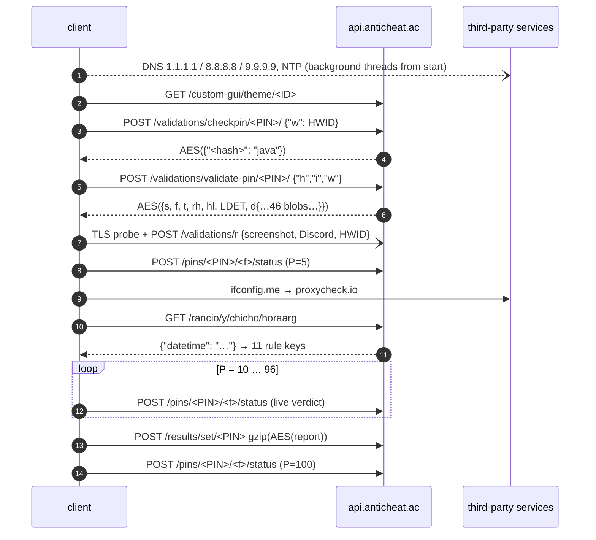
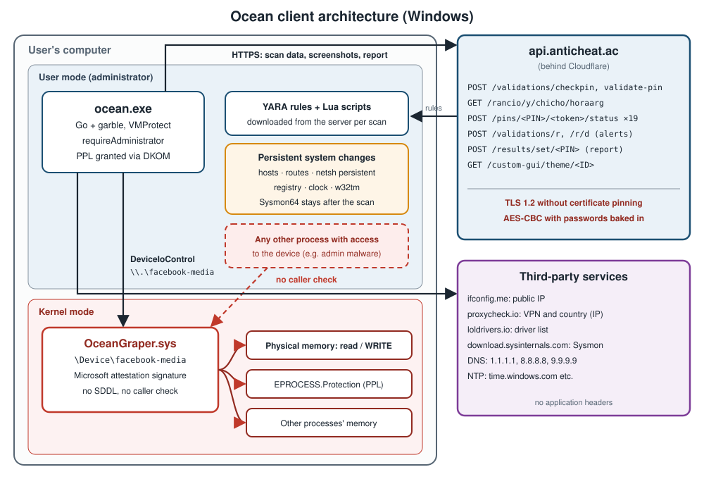
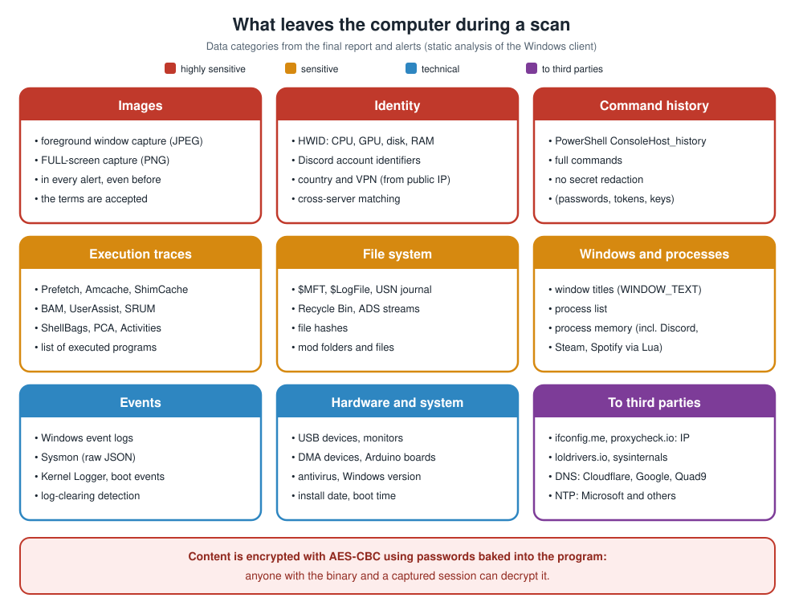

# A Clock, a Sine and "MAQUINADEARMADO": How an Anti-Cheat Client Protects Its API

**Author:** Wojciech Krzysik<br>
**Date:** November 2026<br>
**Subject:** static analysis of the "Ocean Anti-Cheat" client (`ocean.exe`, Windows x64, Go + VMProtect)<br>
**Analysed product:** [Ocean Anti-Cheat](https://anticheat.ac)<br>
**Example of a fabricated scan:** https://anticheat.ac/results/pin/X1P4J6F5 · video: https://youtu.be/3uhOqBqCfqg<br>
**Polska wersja:** [README.md](README.md)<br>
**AI involvement:** the analysis and this text were produced with the help of AI tools (details in section 22).

> **TL;DR**
> - The client sends the server a screenshot, Discord account identifiers, PowerShell history, traces of executed programs and much more.
> - The API has no `Authorization` header, no HMAC, no API key and no certificate pinning.
> - Protocol security rests on three ideas:
>   - content encrypted in the CryptoJS format with passwords baked into the binary;
>   - a "signature" of the final URL after redirects;
>   - a key for the detection rules derived from the **server's clock** through a sum of a million sines.
> - This is obfuscation, not cryptography in the strict sense. It holds only until someone unpacks the binary.
> - A bigger risk for the user than the protocol weaknesses is a **signed kernel driver** that reads and writes arbitrary physical memory without checking the caller, the modification of `EPROCESS`, and persistent changes to networking, the clock and the registry.
> - The **privacy policy** mentions none of these interventions and omits more than a dozen categories of collected data, although the download page claims it "lists every item".
> - For players: a **checklist** (section 20) on how to check for and undo the driver, Sysmon and system changes after a scan.

---

## Table of contents

1. [Why this text](#1-why-this-text)
2. [Before reading anything: VMProtect and garble](#2-before-reading-anything-vmprotect-and-garble)
3. [Traffic map: 16 channels](#3-traffic-map-16-channels)
4. [Transport layer: TLS 1.2 and nothing more](#4-transport-layer-tls-12-and-nothing-more)
5. [Who are you? PIN, HWID and the client's own hash](#5-who-are-you-pin-hwid-and-the-clients-own-hash)
6. [Content encryption: CryptoJS in Go](#6-content-encryption-cryptojs-in-go)
7. [URL "signature": defence against redirects](#7-url-signature-defence-against-redirects)
8. [The best part: a key from a clock and a million sines](#8-the-best-part-a-key-from-a-clock-and-a-million-sines)
9. [What the server sent](#9-what-the-server-sent)
10. [Live progress: a verdict before the scan ends](#10-live-progress-a-verdict-before-the-scan-ends)
11. [Final report: 76 keys you cannot read without the salt](#11-final-report-76-keys-you-cannot-read-without-the-salt)
12. [Alerts, the TLS probe and the watchdog](#12-alerts-the-tls-probe-and-the-watchdog)
13. [What data leaves the computer](#13-what-data-leaves-the-computer)
14. [What it all stands on: the trust model](#14-what-it-all-stands-on-the-trust-model)
15. [Threats to the user: driver, kernel and persistent system changes](#15-threats-to-the-user-driver-kernel-and-persistent-system-changes)
16. [Privacy policy versus code: what matches and what does not](#16-privacy-policy-versus-code-what-matches-and-what-does-not)
17. [Bug gallery](#17-bug-gallery)
18. [Spanish-language easter eggs](#18-spanish-language-easter-eggs)
19. [How the program evolved](#19-how-the-program-evolved)
20. [Checklist for players: what to check after a scan](#20-checklist-for-players-what-to-check-after-a-scan)
21. [Recommendations for the vendor](#21-recommendations-for-the-vendor)
22. [Workshop: how it was read](#22-workshop-how-it-was-read)
23. [Summary](#23-summary)

> [!WARNING]
> **Disclaimer.** This text is a technical analysis for **research and educational purposes** only.
> - It describes the analysis of one version of the program and expresses the author's opinion. It is not legal advice or an accusation of any crime.
> - The analysis was static. The program was not run on a system, and its servers were not contacted from the analysis environment.
> - Secret values (passwords, salts, keys) were deliberately omitted. This article is not a guide to bypassing protections, forging scans or exploiting the vulnerabilities described. Do not use this information for such purposes.
> - Code fragments marked as simplified are illustrations, not the program's literal code. Function names are the author's reconstruction.
> - The vendor may have changed the program after the analysis date. The author accepts no liability for any use of this information.

---

## 1. Why this text

Anti-cheat "scanners" for players have become a software category of their own. A Minecraft or FiveM community asks a player to download a program and enter a PIN. For several minutes the program inspects the computer, and a moderator gets a "legit / suspicious / cheating" report on a website.

Such a program runs with administrator rights, loads its own kernel driver and reads almost everything. What interests me more than the scanning itself is **how it talks to its server**:
- how it protects the collected data from prying eyes;
- how the server makes sure the report has not been forged.

This article answers that question based on a complete, **purely static** analysis of the Windows client.

Rules I followed:
- **The sample was never run on a real system.** Unpacking happened in a CPU emulator (Unicorn), where every Windows API call was handled by a Python stub. Networking was blocked.
- **Secrets are hidden.** Every password, salt and key in the text is replaced with `<REDACTED>`. I show mechanisms, not a ready-made tool for forging reports.
- **Function names are a reconstruction.** The garble compiler replaces identifiers with hashes such as `SRXdjXFy64e0`. Names like `AuthenticateWithAPI` were assigned based on what the code does.

---

## 2. Before reading anything: VMProtect and garble

The binary is protected twice.

**Layer 1: VMProtect.**
- **Packing and startup checks.** The file is packed, and the loader contains anti-debug checks: `ProcessDebugPort`, `ThreadHideFromDebugger`, `NtClose(0xDEADC0DE)` and a single-step trap handled by its own SEH handler.
- **Import hiding.** API calls are replaced with `call`s to "thunks" that compute the function address on the fly.

The emulator ran through the whole loader and dumped the image at the jump to the OEP. Each of the 1,687 thunk call sites was resolved with a separate micro-emulation to find out which API it hides.

**Layer 2: garble (Go).**
- **Identifiers.** Package and function names are hashed.
- **Literals.** Every string literal is encrypted and assembled at run time by a generated state machine.

This is what a decompiled fragment of the function that creates the HTTP client looks like:

```c
// app_winapi_common.DialHTTPConnection (fragment, Ghidra after deobfuscation)
puVar6 = runtime_newobject(&type_net_Dialer);
*puVar6     = 15000000000;          // Dialer.Timeout   = 15 s
puVar6[8]   = 30000000000;          // Dialer.KeepAlive = 30 s
lVar7 = runtime_makeslice(&type_uint8, 0, 0xd);
bVar12 = 7;                         // initial state of the literal machine
while (bVar12 != 4) {               // 4 = final state
    if (bVar12 == 0) {              // append 2 bytes: ('T' - key) ^ 199
        ...
        bVar12 = 5;
    } else if (bVar12 == 1) {       // "unwind": b[i] += i ^ k
        for (i = 0; i < len; i++) buf[i] += (u8)i ^ bVar10;
        bVar12 = 4;
    } else if (bVar12 == 2) {       // append byte 0x2a
        ...
        bVar12 = 0;
    }
    ...
}
```

There are thousands of such blocks. I decoded them in two ways:
- by CPU emulation of **just the decoding block**, from where the data is prepared to the call of the converter;
- by emulating Go `switch` jump tables where garble turned a literal into a state machine.

This recovered 91.9% of the 14,116 literals as clean text. Only then does the code become readable.

---

## 3. Traffic map: 16 channels

I searched the call graph for every reference to `net/http`, `net.Dial*`, the DNS resolver and `crypto/tls`. There are exactly 16 network channels. The program **does not listen** on any port.

| # | Channel | Address | Purpose |
|---|---|---|---|
| 1 | GUI theme | `GET api.anticheat.ac/custom-gui/theme/<ID>` | per-community window styling |
| 2 | PIN pre-check | `POST …/validations/checkpin/<PIN>/` | does the PIN exist, for which game |
| 3 | **authentication** | `POST …/validations/validate-pin/<PIN>/` | session token, configuration, encrypted rules |
| 4 | scan start alert | `POST …/validations/r` | "scan started" + screenshot |
| 5 | progress | `POST …/pins/<PIN>/<token>/status` | 19 times: 5 → 100% |
| 6–7 | IP and VPN | `ifconfig.me/ip`, `proxycheck.io/v2/<IP>?vpn=1&asn=1` | country, VPN |
| 8 | **server time** | `GET …/rancio/y/chicho/horaarg` | seed for the rule keys |
| 9 | LOLDrivers | `loldrivers.io/api/drivers.json` | hashes of vulnerable drivers |
| 10 | Sysmon | `download.sysinternals.com/files/Sysmon.zip` | install or repair Sysmon |
| 11 | **report** | `POST …/results/set/<PIN>` | final result |
| 12 | integrity alerts | `POST …/validations/r/d` | VM, hooks, MITM, timeout |
| 13 | TLS probe | handshake with `anticheat.ac:443` | detect TLS interception |
| 14 | public DNS | `1.1.1.1`, `8.8.8.8`, `9.9.9.9` | detect blocking in `hosts` or DNS |
| 15 | system DNS | Windows resolver, every ~5 s | compare with firewall rules |
| 16 | NTP | `time.windows.com` and others | **sets the system clock** |

One session, simplified:



The whole picture, including what happens in the kernel (section 15):



---

## 4. Transport layer: TLS 1.2 and nothing more

Most requests go through a single function that builds the HTTP client. Its reconstructed Go equivalent:

```go
func DialHTTPConnection(timeout time.Duration) *http.Client {
    d := &net.Dialer{Timeout: 15 * time.Second, KeepAlive: 30 * time.Second}
    tr := &http.Transport{
        DialContext: func(ctx context.Context, _, addr string) (net.Conn, error) {
            return d.DialContext(ctx, "tcp4", addr)     // IPv4 only
        },
        Proxy: nil,                                     // ignores system proxy and HTTP(S)_PROXY
        TLSClientConfig: &tls.Config{
            MinVersion: tls.VersionTLS12,
            MaxVersion: tls.VersionTLS12,               // exactly TLS 1.2
            NextProtos: []string{"http/1.1"},           // no HTTP/2
            // no InsecureSkipVerify, no VerifyPeerCertificate → no pinning
        },
        TLSHandshakeTimeout:   15 * time.Second,
        IdleConnTimeout:       90 * time.Second,
        ExpectContinueTimeout: 1 * time.Second,
    }
    return &http.Client{Transport: tr, Timeout: timeout}
}
```

A few observations:

- **No proxy, IPv4 only.** This makes simply routing the traffic through a local proxy for analysis harder. The client just does not see that proxy.
- **No certificate pinning.** Any certificate from the system CA store is trusted. The authors probably knew this, because they added a separate **TLS probe** (section 12).
- **No retries.** Every request is sent once. The final report does not even have an overall timeout.
- **The same User-Agent everywhere: `MAQUINADEARMADO`.** In Spanish, *máquina de armado* literally means "assembly machine" (more such easter eggs in section 18). It is not a secret: it is sent in the clear with every API request.

A curiosity: three requests (`validate-pin`, LOLDrivers, Sysmon) use Go's default client, which **does honour** `HTTPS_PROXY`. That inconsistency applies to the most important request of all, the authentication.

---

## 5. Who are you? PIN, HWID and the client's own hash

The client identifies itself to the server with three values.

### 5.1 PIN baked into the file name

The PIN has 8 characters and is usually part of the downloaded file's name, e.g. `Ocean-L3V0Z2E0.exe`. The program can also take it from the clipboard or the keyboard. The part after `-` is also used to download the community's GUI theme.

### 5.2 HWID

The HWID is 42 hex characters computed from a few hardware parameters:

```go
func ComputeHWID() string {
    cpu  := strip(wmi("SELECT Name FROM Win32_Processor"))           // spaces removed
    gpu  := strip(wmi("SELECT Caption FROM Win32_VideoController"))  // or EnumDisplayDevicesW
    disk := strip(wmi("SELECT Model FROM Win32_DiskDrive WHERE Index = 0"))
    ramGB := float64(totalPhysicalMemory) / (1 << 30)
    slots := memorySlots()        // SystemMemorySlots registry value or WMI
    speed := firstModuleSpeed()   // SMBIOS via SetupAPI or WMI

    data := fmt.Sprintf("%s%s%s%.2f%d%d", cpu, gpu, disk, ramGB, slots, speed)
    sum  := sha256.Sum256([]byte(data + "<REDACTED: 78-character salt>"))
    return hex.EncodeToString(sum[:])[:42]
}
```

Weaknesses of this construction:
- **Poor uniqueness.** Two identical computers from the same product line produce the same HWID.
- **Easy to change.** Replacing the disk or the graphics card produces a new HWID.

There is also a small bug: when reading the disk model fails, the code overwrites the **GPU** variable instead of the disk (section 17.3).

### 5.3 The client's own hash

On authentication the client sends three fields:

```json
{"h": "<sha256 of its own .exe>", "i": "<md5(PIN)>", "w": "<HWID>"}
```

The `h` field lets the server reject a modified binary. But it only works against someone who changes the file without changing the value sent. The client computes and declares this hash itself, so it is version control rather than real attestation.

---

## 6. Content encryption: CryptoJS in Go

Almost every payload, in both directions, is encrypted with a single function. I reconstructed it from the disassembly:

```go
// format compatible with CryptoJS.AES.encrypt(text, pass) and `openssl enc -aes-256-cbc -md md5 -a`
func encryptString(plain, password string) string {
    salt := make([]byte, 8)
    io.ReadFull(rand.Reader, salt)

    // OpenSSL EVP_BytesToKey with MD5: D_i = MD5(D_{i-1} || password || salt)
    var d, prev []byte
    for len(d) < 48 {
        h := md5.Sum(append(append(prev, password...), salt...))
        prev = h[:]
        d = append(d, prev...)
    }
    key, iv := d[:32], d[32:48]

    block, _ := aes.NewCipher(key)
    ct := pkcs7Pad([]byte(plain), 16)
    cipher.NewCBCEncrypter(block, iv).CryptBlocks(ct, ct)
    return base64.StdEncoding.EncodeToString(append(append([]byte("Salted__"), salt...), ct...))
}
```

Encrypted server responses start with `U2FsdGVkX1`, which is `Salted__` in base64. That gives the format away immediately.

The **passwords** are more interesting than the algorithm:

| Payload | Password |
|---|---|
| `checkpin` response | a 32-digit constant `<REDACTED>` + PIN |
| `validate-pin` response | `hex(sha256(PIN + "<REDACTED>"))` |
| progress statuses | `hex(sha256(session_token + PIN))` |
| `/validations/r` alerts | constant `<REDACTED>`, disguised as the name of a Go library on GitHub |
| final report | another constant `<REDACTED>`, also disguised as a Go library name |
| detection rules (`d`) | key from the server clock (section 8) |

The alert and report passwords look like Go import paths in the style of `github.com/author/package`. Someone running `strings` on the binary will take them for ordinary compilation leftovers. Clever camouflage.

The consequence is serious, though: **anyone who has the binary can decrypt alerts and reports**, because the passwords are constant. Network traffic is still needed, but no server secret is. Of the whole set, only the progress statuses depend on a session secret, the token `f` from the server's response.

AES-CBC without a MAC does not protect integrity either. A modified ciphertext decrypts to garbage instead of being rejected. At most the server can notice that the JSON does not parse.

---

## 7. URL "signature": defence against redirects

After two requests (`validate-pin` and `/horaarg`) the client checks **where it actually ended up**, i.e. the final URL after any HTTP redirects:

```go
func checkFinalURL(resp *http.Response, cut int, secret, want string, code int) {
    if resp.Request == nil || resp.Request.URL == nil {
        os.Exit(224)
    }
    parts := strings.Split(resp.Request.URL.String(), "/")
    if len(parts) < 2 {
        os.Exit(225)
    }
    base := strings.Join(parts[:len(parts)-cut], "/")   // validate-pin: strips "<PIN>/"
    sum := sha256.Sum256([]byte(base + "/" + secret))
    if hex.EncodeToString(sum[:]) != want {
        os.Exit(code)                                   // 226 or 16
    }
}
```

I recomputed both hashes: they match `https://api.anticheat.ac/validations/validate-pin` and `https://api.anticheat.ac/rancio/y/chicho/horaarg`.

Incidentally, this settled a question about the path. The earlier Linux version suggested `/hora`; the hash confirms `/horaarg`.

Assessment:
- **What it protects against:** it detects a redirect (301/302) to another server, e.g. by a local proxy that bounces requests to its own domain.
- **What it does not protect against:** it does not help if an attacker substitutes the response at the **same** address, e.g. via MITM with their own trusted CA. The URL then matches.
- **Nature of the mechanism:** the secret appended to the hash is in the binary, so this is more of a "is the URL exactly this one string" check, in a form that does not show up in `strings`.

---

## 8. The best part: a key from a clock and a million sines

The `validate-pin` response contains an object `d` with more than 40 encrypted blobs:
- compiled YARA and YARA-X rules;
- file lists;
- JVM structure offsets;
- DMA hardware signatures.

The key for them **is not in that response**. The client obtains it like this:

1. It sends `GET /rancio/y/chicho/horaarg` (*hora* is Spanish for "hour").
2. It receives plain JSON `{"datetime": "2026-11-02T16:06:…-03:00"}`.
3. For offsets from −5 to +5 minutes it builds 11 strings in the format `YYYY:MM:DDhh:mm`.
4. From each string it derives a key like this:

```go
func deriveKey(stamp string) string {          // e.g. "2026:11:0216:06"
    p := strings.Split(stamp, ":")
    year, month := atof(p[0]), atof(p[1])
    ddhh, minute := atof(p[2]), atof(p[3])     // "0216" → 216

    x := minute + year*60 + month/ddhh

    var sum float64
    for k := 1; k <= 999999; k++ {             // a million terms of the series
        sum += math.Sin(float64(k)*x) / math.Sqrt(float64(k))
    }
    return fmt.Sprintf("%.6f", sum)            // key = the number as text with 6 decimals
}
```

5. It tries each of the 11 keys on the blobs in turn. A result is accepted when it is valid JSON or contains the word `import` or `YARA`.

The idea is original. The series `Σ sin(kx)/√k` is conditionally convergent and its values are hard to predict "by eye", while a million iterations cost a dozen or so milliseconds. The server can change the key every minute without ever sending it in the clear. The ±5-minute window tolerates clock drift. This is probably why the client **resets the system clock via NTP** (channel 16), which is quite invasive in itself.

The weakness is obvious, though. **The key's entropy is one minute of server time.** A day has 1,440 minutes and there are a few dozen time zones. Knowing the approximate time a response was captured is enough to try all candidates in a fraction of a second. In a test capture (traffic reproduced outside the program) the correct key turned up after **259 tries**. It also revealed that the server clock runs in **UTC−3**, which fits the Spanish messages in the code.

So this "key" is not a secret. It is a timestamp passed through a deterministic function that is publicly written down in the binary. It protects the rules from casual viewing, but not from an analyst.

---

## 9. What the server sent

Analysing the binary tells you what the client **can** do. The server's response shows what it is **told** to do.

The client's request sequence was reproduced outside the program, without running the sample: GUI theme, `checkpin`, `validate-pin`, DNS and NTP. The run stopped before `/horaarg`, the statuses and the report, so no report or screenshot was sent. Everything below was decrypted and analysed offline, without executing any server-supplied code.

### 9.1 A 4.5 MB package

The `validate-pin` response was **4.5 MB** and entirely encrypted (CryptoJS, section 6). After decryption it contained:

| Field | What arrived | Meaning |
|---|---|---|
| `s`, `t` | `true`, `"java"` | success, Minecraft/Java profile |
| `f`, `rh` | 64 and 16 hex characters | session token and report key salt (values omitted) |
| `l`, `ru`, `jajaae` | `"False"`, `"false"`, `"false"` | custom modules, cheat class scan and JVM memory scan **disabled** for this PIN |
| `cs`, `sus` | `"eselmesatraptoloculopatra"`, `"nopi nopi"` | plain Spanish jokes instead of encrypted rules. Unused, because `l != "True"` |
| `hl` | 9 SHA-256 hashes | "forbidden" Windows service names, hashed with a 275-byte constant |
| `LDET` | 32 kB | 4 Lua scripts (section 9.3) |
| `d` | **44 blobs** | module rules and configuration (section 9.2) |
| `SysmonExpected` | `false` | **a field the analysed binary does not know at all** |

### 9.2 44 blobs: YARA with scrubbed values

I recovered the blob key with the method from section 8: 259 candidates for the "server minute" were enough. A single key opened all 44 blobs:
- **17 sets** of compiled YARA rules (libyara format);
- **13 sets** of YARA-X rules (serialized `Rules`);
- **14 JSON configurations**.

The server applies its own obfuscation here:
- **Rule names and JSON keys** are random 20-letter strings. Detection names reveal nothing about what they detect.
- **Configuration values** are often `AAAA…` or `aaaa…` fillers of varying length. It is unclear whether this is a per-customer mask or deliberately scrubbed data.
- **Literals in the rules** survived compilation. They show what the rules look for: cheat domains and loaders, classes such as `autoclicker.class` or `aimassist.class`, packer signatures (Themida, VMProtect, Enigma), monitor models and capture cards used in DMA hardware, Arduino-style boards (hardware macros), EFI/GRUB paths (dual-boot detection).

The literals also contain PDB paths with the account names of authors of various tools. I do not reproduce this third-party data here.

### 9.3 Lua after Prometheus

The `LDET` field is base64 → gzip → JSON with four compiled **Lua 5.4** scripts. The bytecode kept its debug information, and the chunk names look like `@/tmp/mig_….lua`, which are traces of the server-side build environment.

The scripts went through two obfuscators:
- **Prometheus**: a constant table, base64 and base85 with a shuffled alphabet, control flow turned into a state machine;
- a second one that wraps variables in metatables.

There were no Lua tools on the machine, so I wrote my own Lua 5.4 disassembler and decoders for both obfuscators. After reconstruction:

| Script | What it checks |
|---|---|
| 1 | patched `ntdll` syscall stubs in `steam.exe`, `Discord.exe`, `Spotify.exe`, `RuntimeBroker.exe`, `consent.exe` |
| 2 | hijacked Authenticode signature verification in the registry (`CryptSIPDllVerifyIndirectData`) |
| 3 | PowerShell 7 (`pwsh.exe`) launched in the current boot session |
| 4 | a 16-byte signature in game process memory, followed by a record with a colour, user name and message |

None of the scripts uses the network, writes files or starts processes. Two of them, however, have bugs that stop them from working as the author intended (section 17).

### 9.4 The server is newer than the client

The response reveals that a **newer protocol version** runs on the other side:
- **Unknown field.** `SysmonExpected` does not exist in the analysed client's response structure.
- **Mismatched `d` tags.** The binary knows 46 tags (64-character hashes) and the server sent 44. **The client does not know 4 of them**, and the server left out 6 known ones.

So the server serves several client versions at once, and the analysed sample is not the latest.

---

## 10. Live progress: a verdict before the scan ends

The client reports progress **19 times** (5, 10, 15, … 96, 100%). Each report is a synchronous POST, and the scan waits up to 60 s for the response:

```go
func ReportScanProgress(p int) {
    inner := map[string]any{
        "P": p,                 // percent
        "R": verdict(),         // "legit" | "suspicious" | "cheating"
        "S": "scanning",        // always "scanning": "finished" is set AFTER the last send
        "E": false, "F": nil, "H": "",
    }
    pass := hex(sha256(sessionToken + PIN))
    body := map[string]string{"r": base64(encryptString(json(inner), pass))}  // double base64
    post("https://api.anticheat.ac/pins/"+PIN+"/"+sessionToken+"/status", body)
}

func verdict() string {
    switch {
    case anyDetectContains("out of instance", "boot instance", "in instance"):
        return "cheating"
    case detectCount == 0:
        return "legit"
    default:
        return "suspicious"
    }
}
```

Two things are worth noting:

1. **The server sees the verdict during the scan.** If the process is killed halfway, the moderator still sees the last state, e.g. `suspicious` at 60%.
2. **The `"finished"` status never reaches the server.** The last send (P=100) happens before `S = "finished"` is set, and nothing sends it afterwards. The server has to infer the end of the scan from `P == 100`. A small ordering bug.

---

## 11. Final report: 76 keys you cannot read without the salt

The report is a `map[string]any` built from dozens of modules. It is sent like this:

```go
body := gzipLevel9(json.Marshal(map[string]string{
    "r": base64(encryptString(reportJSON, "<REDACTED: constant disguised as a Go library>")),
}))
post("https://api.anticheat.ac/results/set/"+PIN, body)   // note: no Content-Encoding: gzip
```

One thing sets this report apart: **key names are hashed with a salt from the server**.

```go
rh := authResp.RH                       // salt from the validate-pin response, e.g. 16 hex characters
key := func(name string) string { return hex(md5(name + rh)) }

report[key("HWID")]        = hwid
report[key("HWID") + "_"]  = hex(md5(hwid + rh))        // value "signature"
report[key("SCREENSHOT")]  = base64(jpeg)
report[key("DETECTS")]     = detects                    // []string
...
```

Without `rh` you cannot tell which key is which.

Ten text fields also have a "twin" with a `_` suffix and the value `md5(value + rh)`:
- `AUTH_HASH`, `HWID`, `VPN`, `COUNTRY`;
- `BOOT_TIME`, `GAME_TIME`, `RECYCLE_BIN`, `SCREENSHOT`, `SCAN_TIME`, `WINDOWS_VERSION`.

This is a simple integrity check, but the client knows `rh`. Anyone who captures the `validate-pin` response can recompute all the signatures. The key concept is again **obfuscation against an observer**, not protection against a party that controls the client.

The server's response to the report is **ignored**. The "Scan Finished" screen appears regardless of whether the upload succeeded.

---

## 12. Alerts, the TLS probe and the watchdog

Several "protective" threads run alongside the main flow.

### 12.1 TLS probe

Before each alert the client connects to `anticheat.ac:443`, performs **only a TLS handshake** without any HTTP request, and verifies the certificate chain on its own. If it detects interception, it does two things:

```go
if tlsIntercepted() {
    sendAlert("/validations/r/d", "...")   // report it
    os.Exit(77)                            // and quit
}
```

This is the answer to the lack of pinning in the main HTTP client. It is built as a **detector**, though, not a safeguard: it does not protect the requests themselves, it just ends the process when something looks suspicious.

### 12.2 Integrity alerts

Various events go to `/validations/r/d`:
- virtual machine detection: VirtualBox, VMware, Hyper-V, KVM, QEMU, Parallels, even the any.run sandbox;
- hooks on physical disk access;
- anti-debug detections;
- TLS interception.

Every alert carries the same content:

```json
{
  "RUNNINGP": "<suspicious processes>",
  "SSL": "<TLS probe result>",
  "anydesk_ss": false,
  "discord": "<base64 JSON of Discord accounts>",
  "game": "java",
  "hwid": "<HWID>",
  "pc_start": "<system start time>",
  "pin": "<PIN or detection description>",
  "screenshot": "<PNG of the whole screen in base64>"
}
```

The key detail: **every alert sends a full-screen screenshot and Discord account data**. VM alerts can go out **before the user even enters the PIN**, because the threads run from process start.

### 12.3 Watchdog

The watchdog checks the scan state every 0.5 s and has three thresholds:
- **T1:** the scan has not started within 30 min;
- **T2:** no progress for 20 min;
- **T3:** the scan has been running for more than 75 min.

Crossing a threshold triggers an alert and `exit(40)`. The messages are in Spanish, e.g. `"[T1] Pre-scan timeout: %s sin arrancar el scan"`.

### 12.4 Exit codes

The client terminates on almost any API problem; there is no offline mode:

| Code | Cause |
|---|---|
| 16 | wrong URL after `/horaarg` |
| 18 | HTTP 417 in console mode |
| 40 | watchdog |
| 77 | TLS interception |
| 222–229 | consecutive `validate-pin` stages: request, transport, URL, integrity, read, decryption, game validation |

---

## 13. What data leaves the computer



This list says more about the program than the cryptography does. Based on the structure of the report and the alerts:

| Category | Details | Channel |
|---|---|---|
| **Images** | capture of the foreground window (JPEG); a **full-screen** capture (PNG) in every alert | report, alerts |
| **Identity** | HWID, **Discord** account identifiers, country and VPN status (via proxycheck.io, from the public IP) | report, alerts |
| **Command history** | `POWERSHELL_HISTORY`: full commands from `ConsoleHost_history.txt`; secret redaction covers only one detector | report |
| **Execution traces** | Prefetch, Amcache, ShimCache, BAM, UserAssist, SRUM, PCA, Activities, `EXEC_LIST` | report |
| **File system** | `$MFT` and `$LogFile` parsing, USN journal, Recycle Bin, ADS streams, file hashes (`FILE_HASHES`) | report |
| **Events** | Windows and Sysmon event logs (raw JSON), boot events, Kernel Logger | report |
| **Hardware** | USB devices (`USBLogs`), DMA devices, monitors, Arduino-style boards (hardware macros) | report |
| **Games** | mod folders, mod contents, alternate accounts, JVM connection logs, "X-RAY" data | report |
| **Windows** | window titles (`WINDOW_TEXT`) | report |
| **Environment** | antivirus products, Windows version, boot time, install date, "factory reset" | report |

A few remarks:
- **In everyday terms:** the scope is very broad, but typical for this category of tools. Players agree to an "inspection", usually without knowing that it includes, for example, PowerShell history with any passwords that may be in old commands.
- **Third-party services:** `ifconfig.me` and `proxycheck.io` receive the user's public IP without any application header.
- **Remote rules:** YARA rules and Lua scripts come from the server, so the server can change **what** the scan looks for. The set of operations the client can perform at all is, however, fixed in the binary. Lua runs in a restricted sandbox (only the base, table, string, math and coroutine libraries; `os`, `io` and `load` are most likely nulled), but with host functions `readpmem`, `ReadRegKey` and `ScanPattern`.

---

## 14. What it all stands on: the trust model

The security model of this API fits in one sentence: **"the client is trusted, as long as nobody looks inside".**

| Mechanism | Protects against | Does not protect against |
|---|---|---|
| TLS 1.2, no proxy, IPv4 only | network eavesdropping, a simple proxy | MITM with a trusted CA (hence the TLS probe) |
| TLS probe | tools like Fiddler/mitmproxy with their own CA | traffic it does not cover; a patched binary |
| CryptoJS with constant passwords | viewing in logs of an intermediate server | anyone who has the binary |
| URL "signature" | a redirect to another host | a substituted response at the same address |
| clock-derived key | viewing the rules without capturing `/horaarg` | searching ~10³ candidates |
| `rh` salt in report keys | correlating fields across sessions | capturing `validate-pin` |
| `.exe` hash in `validate-pin` | an old or foreign binary | a client that sends the expected hash |
| VMProtect + garble | quick static analysis | patient emulation (this article) |

What I **did not find**:
- request signing (HMAC/ECDSA) with a key the client does not know;
- hardware attestation (TPM, Measured Boot) tied to the report; the client does read Secure Boot and TPM state, but only as report data;
- session keys with a Diffie-Hellman exchange;
- certificate pinning in the HTTP client.

This is not a criticism of the idea itself. In a model where the adversary is the **owner of the computer**, every secret in the client leaks sooner or later. Real protection lies on the server side: data correlation, statistical analysis, the human factor (the moderator). What is interesting is how much ingenuity went into a layer that is by definition only a speed bump:
- a million sines;
- passwords disguised as library names;
- hashed report keys.

The protocol weaknesses are mainly Ocean's own problem, though. For the owner of the scanned computer, what the program does to their system matters more. That is the subject of the next section.

---

## 15. Threats to the user: driver, kernel and persistent system changes

The client starts with a `requireAdministrator` and `autoElevate` manifest, so always with full administrator rights. That in itself is typical for this class of tools. The problem is what it does with those rights.

### 15.1 Its own kernel driver with a memory read/write primitive

The `.data` section of the binary contains an **embedded driver** (23,712 bytes). The client:
1. writes it to disk as `OceanGraper.sys`;
2. creates the "Ocean Graper Driver" kernel service via `CreateService`;
3. starts it.

Driver details:
- **Signature.** The driver carries a Microsoft attestation signature (Windows Hardware Compatibility Publisher, May 2025), so it loads on ordinary Windows without test mode.
- **Origin.** The PDB path points to a project called `IceCubes-Driver\…\Windows-Ice-Monitor.pdb`, a completely different name from "Ocean".
- **Device name.** The device is called `\Device\facebook-media`. It has nothing to do with Facebook; it looks like a name chosen not to attract attention.

A fragment from the decompiled `DriverEntry`:

```c
// OceanGraper.sys, DriverEntry (Ghidra)
status = IoCreateDevice(DriverObject, 0, &DeviceName /* \Device\facebook-media */,
                        FILE_DEVICE_UNKNOWN /* 0x22 */, 0, FALSE, &DeviceObject);
//        ^ no IoCreateDeviceSecure / SDDL, no FILE_DEVICE_SECURE_OPEN
IoCreateSymbolicLink(&DosName /* \DosDevices\facebook-media */, &DeviceName);
DriverObject->MajorFunction[IRP_MJ_DEVICE_CONTROL] = DispatchIoctl;
```

The IOCTL dispatcher **does not check who is calling**. There is no comparison of the PID with the Ocean process and no token check, and the input buffer is controlled by the caller. The most important codes:

| IOCTL | Action |
|---|---|
| `0x222000` / `0x222004` | read / **write** the virtual memory of **any process**: its own page-table walk from a supplied CR3 |
| `0x222018` / `0x22201c` | read / **write arbitrary physical memory** (`MmMapIoSpaceEx` at an address from the user buffer) |
| `0x222020` / `0x222024` | `ZwAllocateVirtualMemory` / `ZwProtectVirtualMemory` in another process |
| `0x222040` | `ZwQueryVirtualMemory` in another process |
| `0x222008` / `0x22200c` / `0x222010` | process and module base addresses (PEB) |
| `0x222014` | calls a `win32kfull.sys` function found by signature, with a window handle; most likely sets a window's *display affinity* |

```c
// OceanGraper.sys: physical write (IOCTL 0x22201c), simplified
NTSTATUS PhysWrite(PHYS_REQ *r) {            // r comes straight from the user buffer
    void *va = MmMapIoSpaceEx(r->PhysAddr, r->Size, PAGE_READWRITE);
    if (!va) return STATUS_UNSUCCESSFUL;
    memcpy(va, r->Buffer, r->Size);          // any physical address, any content
    MmUnmapIoSpace(va, r->Size);
    return STATUS_SUCCESS;
}
```

**Why is this dangerous?** Writing arbitrary physical memory means, in practice, **full control over the kernel**. It allows replacing a process token with the SYSTEM token, disabling security callbacks or loading unsigned code. This is exactly what **BYOVD** (*Bring Your Own Vulnerable Driver*) attacks exploit: a vulnerable but validly signed driver becomes a gateway to the kernel.

- **Who can use it?** As long as the driver is loaded, any process that manages to open `\\.\facebook-media`. Certainly any process with administrator rights. Whether an ordinary user can too depends on the device's default security descriptor; I did not verify this dynamically.
- **Consequence.** Even in the "administrator only" case, malware with admin rights gets a free **admin → kernel** transition. That boundary is exactly what Windows tries to hold with Driver Signature Enforcement and HVCI.
- **Cleanup.** Code that removes the driver exists: `sc stop`, `fltmc unload`, `sc delete` and `MoveFileEx` with delayed deletion. Its execution, however, depends on a configuration flag. Static analysis cannot determine whether the driver always disappears after the scan. If it stays, the attack window does not close with the scan.
- **Older version.** The client also detects and removes an older driver, `OceanDrv.sys`, which suggests the drivers changed between versions.

> A driver with this profile (attestation signature, physical write, no access control) is a candidate for the [LOLDrivers](https://www.loldrivers.io/) list. Ironically, the client itself downloads that list to detect vulnerable drivers on the player's machine.

### 15.2 DKOM: a process you cannot close

At startup (`main.init.0`) the client calls `InitSelfProtection`:

```go
func InitSelfProtection() {
    CheckKasperskyFilterDriversRunning()          // only checks via SCM, stops nothing
    if !config.SelfProtect {                      // configuration flag
        return
    }
    pid := GetCurrentProcessId()
    eproc := findEPROCESS(pid)                    // walks ActiveProcessLinks through the driver
    off := protectionOffset()                     // from disassembling PsIsProtectedProcessLight
                                                  // in ntoskrnl.exe loaded in user mode
    if PhysWrite(eproc+off, PS_PROTECTED_LIGHT) != nil {
        RetryDkomAfterDriverCleanup()
    }
}
```

The program **directly modifies the kernel `EPROCESS` structure**, giving itself protected process (PPL) status. The download page openly says so: "Ocean runs as a protected process, so it cannot be closed from Task Manager while it scans". It does not mention **how** this is achieved.

Risks of this mechanism:
- **Undocumented kernel writes.** `EPROCESS` offsets change between Windows builds. The program computes them heuristically (signatures, disassembly). A mistake means a write to the wrong place in a kernel structure: a BSOD at best.
- **Taking control away from the user.** PPL is normally reserved for system components and antivirus products with an ELAM certificate. Here it goes to a program the user cannot kill from Task Manager and that antivirus cannot freely scan.
- **A channel for others.** The same primitive (section 15.1) lets anyone with access to the device do the same for **any** process, e.g. make a malicious process "unkillable".

### 15.3 Persistent network configuration changes

The integrity module treats blocking of Ocean's servers as a "bypass attempt" and **fixes it on its own**. The user gets the message: "A bypass attempt was detected and has been fixed. Restart the tool and it will work correctly." The changes include:
- clearing entries in `hosts` and resetting the proxy;
- `ipconfig /flushdns`;
- `route.exe`: reading the routing table and deleting routes;
- `netsh interface … store=active` **and `store=persistent`**, i.e. changes that survive a reboot;
- **deleting registry values** in `Internet Settings\ZoneMap\EscDomains`.

In practice the program **reverts deliberate decisions of the computer's administrator**: `hosts` entries, routes (e.g. for a corporate VPN), interface settings. It does not ask for consent and does not make a backup.

### 15.4 The system clock and the Windows Time service

- **Clock.** The NTP thread enables `SeSystemtimePrivilege` and calls `SetSystemTime`. There is no visible drift threshold, so the clock is set whenever a time is obtained. NTP is unauthenticated plain UDP, and the program does not even check the LI or stratum fields.
- **Windows Time service.** When all NTP servers fail, the program **persistently reconfigures** the service: `w32tm /register`, `/config /manualpeerlist:"…" /syncfromflags:manual /reliable:YES /update`, `net stop w32tm`, `w32tm /resync /force`.

Changing the time affects everything that depends on it: Kerberos in a domain, certificate validity, logs, scheduled tasks. On a work computer this can cause a real outage.

### 15.5 Sysmon stays on the system

The `app_sysmon_events` module can download `Sysmon.zip` from `download.sysinternals.com`, verify the Microsoft signature and **install or repair Sysmon** with its own configuration:

```text
"%s" -accepteula -i "<SysmonConfig.xml>"      // the EULA is accepted on the user's behalf
```

The client then writes its state (`sysmon_state.json`) and, on later scans, checks whether Sysmon has been removed, disabled or reconfigured. It uses codes such as `sysmon_exe_deleted`, `sysmon_service_stopped`, `sysmon_config_mismatch`, `sysmon_log_cleared` and others.

A system service with the `SysmonDrv` kernel driver therefore **stays on the computer after the scan**. If the user removes it, that will later be recorded as "tampering".

### 15.6 Remotely controlled scan scope

YARA and YARA-X rules, file lists and Lua scripts come **from the server** with every scan (the `d` and `LDET` fields). The Lua host API includes, among others:
- `readpmem(pid, n)`: reading process memory;
- `ScanPattern`: searching processes for patterns;
- `ReadRegKey`: reading the registry;
- `get(…)`: access to forensic artifacts collected earlier by the client.

In the captured session, one of the scripts scanned the memory of `Discord.exe`, `steam.exe`, `Spotify.exe` and `consent.exe`, i.e. processes **unrelated to the game**.

The Lua sandbox is restricted (no `io`, `os`, `load`), and none of the scripts examined used the network or wrote files. Still, **what the scan looks for can change from one day to the next without a program update** and without the user's knowledge.

### 15.7 Smaller risks

- **Passwords baked into the binary.** Reports and alerts are encrypted with constant passwords (section 6). In practice only TLS protects against eavesdropping, and the HTTP client does not pin the certificate.
- **Data in the report.** PowerShell history goes to the server **without secret redaction**. Passwords, tokens and API keys once typed in a console can end up in a third-party company's database.
- **Data before consent.** The integrity threads start before the terms screen. A VM detection alert with a **full-screen screenshot** and Discord data can go out before the user accepts anything (section 12.2).

### 15.8 Risk summary

| Threat | Impact | Persistence | User awareness |
|---|---|---|---|
| driver with physical memory write | **critical**: escalation to kernel, BYOVD | until unloaded (conditional cleanup) | not mentioned in the policy or the terms |
| DKOM / PPL | high: BSOD risk, loss of control over the process | while running | vague mention on the download page |
| `hosts` / route / `netsh` / registry changes | medium: lost configuration | **persistent** | message after the fact |
| `SetSystemTime` and `w32tm` | medium: Kerberos, certificates, logs | **persistent** (service configuration) | none |
| Sysmon installation | low–medium: new service and driver | **persistent** | general mention in the policy ("with your consent") |
| remote rules and Lua reading memory | medium: variable scope of surveillance | per scan | none |

---

## 16. Privacy policy versus code: what matches and what does not

Ocean's privacy policy (version of 20 October 2026) and terms of service (11 March 2025) describe what data is collected and how it is protected. I compared these statements with what the analysed Windows client **actually does**.

> Disclaimer: this is a technical comparison, not legal advice. The analysis covers one client version. The server side (storage, access, retention) is beyond the reach of binary analysis.

### 16.1 What is described accurately

- The **full-screen screenshot** is mentioned explicitly, with the caveat that it may include windows unrelated to the game.
- **VPN detection** (proxycheck.io), the **operating system version**, **"hashed hardware identifiers"** and **process data** are mentioned.
- **Sysmon** is mentioned, including the fact that it remains after the scan and logs for future scans.
- **Discord data** appears in the terms ("Associated Discord information").
- **Cross-server summaries** (policy section 22) are described: date, result, game and match type (HWID, Discord account, "linked HWID").
- **Google Analytics.** The website code does set `analytics_storage: denied` by default for EEA countries, the UK and Switzerland and `granted` elsewhere, with advertising signals disabled. That matches the description.

### 16.2 What the policy does not say

| What the client does | What the policy or terms say |
|---|---|
| **installs a kernel driver** with arbitrary physical memory write (section 15.1) | **nothing**. The word "driver" appears only in the terms' ban on using *other people's* drivers |
| **modifies `EPROCESS`** (PPL) | nothing. The download page only says "runs as a protected process" |
| changes `hosts`, routes, `netsh` (persistent), deletes registry values | nothing |
| sets the system clock and reconfigures `w32tm` | nothing |
| sends the **full PowerShell history** (`POWERSHELL_HISTORY`) | nothing; the closest is a generic "system telemetry" |
| sends **window titles** (`WINDOW_TEXT`), the process list, installed antivirus | nothing |
| parses **`$MFT`, `$LogFile`, the USN journal**, Recycle Bin, ADS, file hashes | nothing |
| collects execution traces: Prefetch, Amcache, ShimCache, BAM, UserAssist, SRUM, ShellBags, PCA | partly: "system startup execution records" suggests a much narrower scope |
| **USB device history**, monitors, DMA devices and Arduino-style boards | nothing |
| mod folders and **mod contents**, alternate accounts, game connection logs | partly: "gaming platform identifiers" |
| reads the **memory of non-game processes** (Discord, Steam, Spotify) through remote Lua scripts | "specific process memory data for integrity verification", without saying it is not only the game |
| **public IP** sent to `ifconfig.me` and `proxycheck.io` | the list of third parties (policy section 13) names only Lemon Squeezy, analytics and cloud storage |
| queries to `loldrivers.io`, `download.sysinternals.com`, public DNS (Cloudflare, Google, Quad9) and NTP | nothing |

The download page claims: "A scan collects the system version, hashed hardware identifiers, records of what ran and when, and the state of the game's processes. **The privacy policy lists every item.**" Based on the code, **this statement is false**. The policy omits more than a dozen of the data categories in the table above, and some of them, such as PowerShell history, can contain highly sensitive data.

### 16.3 Statements that are inaccurate or contradict the code

1. **"Hardware Identifiers: … CPU, GPU, and motherboard models".** The HWID in the code is built from the CPU, GPU, **disk model**, RAM size, slot count and memory speed. There is no motherboard in the formula, and the disk is not mentioned in the policy.
2. **"Full-screen desktop screenshots: captured during scan initialization".** A full-screen capture is sent by **every integrity alert**, not just at scan start: VM detection, debugger, disk hook, TLS interception and each of the three watchdog thresholds. VM alerts can go out **before the terms screen**, i.e. before the consent the policy relies on ("By accepting our Terms of Service and initiating the scan, you explicitly agree"). On top of that, the final report contains a separate capture of the foreground window.
3. **Sysmon "with your explicit consent".** In the client code I **did not find any separate consent prompt** for installing Sysmon. There is only a general terms screen with links to the policy. The installation calls `Sysmon64.exe -accepteula -i`, i.e. it accepts Microsoft's licence on the user's behalf. Consent "given" by accepting bundled terms can hardly be called *explicit* in the sense of Article 7 GDPR.
4. **"End-to-end encryption" (policy section 11) and "industry-standard encryption" (policy section 4).** The report content is encrypted with AES-CBC, an MD5-derived key (`EVP_BytesToKey`), no MAC and a **constant password baked into the program**. This is not end-to-end encryption: the server decrypts the data, and anyone with the binary knows the password. The actual protection in transit is TLS 1.2, without certificate pinning.
5. **Storage location.** The policy says "servers located in the United States **and Argentina**", while the terms say "all data is stored in secure **US-based** servers". The documents contradict each other. Traffic also goes through Cloudflare.
6. **Rights of scanned people.**
   - Policy (section 8): "we guarantee the following rights: … Request information about your stored data and obtain copies … request deletion".
   - Terms (section 8): "scan subjects (third parties) have **no inherent access rights** to results", and deletion requests "require legitimate justification … **may be denied** if request affects customer's legitimate interests".

   The right of access under Article 15 GDPR does not require any justification. The two documents exclude each other, and the scanned person is precisely the player whose data the client collects.
7. **Legal basis "performance of a contract" (Art. 6(1)(b)).** The contract with Ocean is concluded by the **game server's administrator** who buys the licence. The scanned player usually has neither an account nor a contract. Relying on contract performance towards them is questionable at the very least.
8. **Retention.** The policy promises automatic deletion after 21 days (for banned users), and the terms promise deletion of screenshots after 21 days. At the same time the policy describes:
   - "Historical Scan Records";
   - "Centralized Database Access … across the Ocean Anticheat network";
   - cross-server summaries matched by HWID;
   - a paid "Look up players in the Ocean cheater database" service.

   For an ordinary scanned player the retention period is not defined anywhere. The pricing page also shows that **access to player history is a product sold to customers**. That is hard to reconcile with "we do not share personal information with third parties except…".
9. **Opting out of cross-server summaries.** They can be turned off by "Users … in Settings", i.e. Ocean account holders. A scanned player without an account can only send a request, "handled manually".
10. **"Data collection boundaries are strictly defined" (policy section 18).** The scan scope is largely defined by **rules and scripts downloaded from the server** on every scan (section 15.6). The boundaries are therefore variable and invisible to the user.
11. **Children.** The policy forbids use of the service by people under 13 and requires parental consent for ages 13–17, but this applies to **accounts**. The client scans anyone who has a PIN, with no age verification whatsoever. In games such as Minecraft or Roblox a large share of players are minors.

### 16.4 Things to note beyond the code

- **"Discord Tracking".** The policy admits that Ocean collects **message history, roles and join dates** from Discord servers deemed "cheating communities". This applies to people who have never had any contact with Ocean. It cannot be verified from the client, but it is a declaration of large-scale collection of third parties' communications.
- **Ban on analysis.** The terms forbid reverse engineering (section 7.1.1) and publishing information about how the service works (section 8). This limits users' ability to independently verify the above statements, although in the EU decompilation for certain purposes (e.g. interoperability) is permitted regardless of the licence.

### 16.5 Verdict

The privacy policy **does not lie outright** about the most visible data: the screenshot, HWID, VPN, Discord, Sysmon. It **omits and generalises** far more:
- **Invasive actions on the system** (a kernel driver with physical memory write, modification of `EPROCESS`, changes to networking, the clock and the registry) **are not mentioned at all**.
- **More than a dozen categories of data**, including PowerShell history, window titles, `$MFT`/USN and USB history, are not listed. Meanwhile the download page claims the policy "lists every item".
- **The descriptions of encryption** ("end-to-end", "industry-standard") do not match the implementation.
- **Consent** to Sysmon and screenshots is in practice bundled or obtained after the fact.
- **The terms and the policy contradict each other** on server location and the rights of scanned people.

---

## 17. Bug gallery

Code written under time pressure leaves traces. The ones found here are harmless to the user, but they show well how the program was built.

### 17.1 A scan that never finishes

```go
ReportScanProgress(100)        // sends {"P":100, "S":"scanning", ...}
state.S = "finished"           // ...and only then changes the status
// and nothing ever sends that status
```

The function that sends the status has **one** caller. The `"finished"` status exists in the code but never reaches the server. The server has to guess the end of the scan from `P == 100`.

### 17.2 `RUIN_DATA`: the last one wins

```go
// simplified
report[key("RUIN_DATA")] = first      // first assignment
...
report[key("RUIN_DATA")] = second     // same key, second value
```

`RUIN_DATA` (data from the module that scans for Minecraft cheat classes) is assigned twice under the same key. The second assignment overwrites the first, so the first value never makes it into the report.

### 17.3 An HWID with the graphics card instead of the disk

```go
// simplified
gpu, err := readGPU()
if err != nil { gpu = "nohay" }
disk, err := readDisk()
if err != nil { gpu = "nohay" }   // should be: disk = "nohay"
```

When reading the disk model fails, the program "invalidates" the graphics card. Two different computers with a failing disk read and different GPUs can therefore get the same HWID. The same computer can also get different HWIDs depending on whether WMI happened to respond.

### 17.4 A Lua script that never reports anything

The server-supplied script looking for patched syscall stubs does, in simplified form:

```lua
-- simplified
local found = ScanPattern(pattern, "Discord.exe")   -- the host returns true/false
if found == 1 then                                   -- the script expects a number
    flag("ntdll syscall stub patched in Discord.exe")
end
```

`ScanPattern` returns a boolean and the script expects a number. The condition is never true, so `flag()` never runs. The script scans the memory of six processes and never reports anything.

Another script starts with `require("json")`, while the sandbox only loads the base, table, string, math and coroutine libraries. It most likely aborts on its first line.

### 17.5 "Cheating" depends on one word

```go
func verdict() string {
    for _, d := range detects {
        if strings.Contains(d, "out of instance") ||
           strings.Contains(d, "boot instance") ||
           strings.Contains(d, "in instance") {
            return "cheating"
        }
    }
    ...
}
```

The live verdict and the report's `SENTENCE` field ("2" = cheating) come from **text matching**, not from the type or weight of a detection. The difference between "suspicious" and "cheating" is the presence of a phrase with the word *instance* in the description. Changing the wording of a detection message is enough to silently change verdicts.

### 17.6 Smaller ones

- **"Review the scan results on the website."** The final screen shows this sentence **regardless of whether the report arrived at all**. The server's response to the report upload is ignored.
- **Gzip without a header.** The report is gzip-compressed but has no `Content-Encoding: gzip`. The server has to know to decompress it.
- **Double base64.** `encryptString` already returns base64, and the result is base64-encoded a second time.
- **Different GUI and console behaviour.** HTTP 417 on authentication terminates the process in console mode (`exit(18)`), while the GUI only shows "Invalid PIN".

---

## 18. Spanish-language easter eggs

Everything points to an Argentine team. The privacy policy gives an address in Córdoba, and the server clock runs in **UTC−3** (section 8). Plenty of the authors' language remains in the code; below is only what is not a secret.

| Where | Text | Meaning |
|---|---|---|
| mutex blocking a second copy | `Local\oceanjajaprendido` | "ocean, haha, on" (*prendido*: switched on, lit). A second copy exits with code 11 |
| API path | `/rancio/y/chicho/horaarg` | *rancio* means "stale", *chicho* is most likely a nickname, *hora* means "hour", and *arg* probably "Argentina" |
| User-Agent | `MAQUINADEARMADO` | *máquina de armado*, literally "assembly machine" |
| watchdog T1 | `Pre-scan timeout: %s sin arrancar el scan` | "…without starting the scan" |
| watchdog T2 | `Scan stalled: %s sin progreso` | "scan stalled: %s without progress" |
| driver installation | `Driver embebido escrito en: %s (%d bytes)` | "embedded driver written to…" |
| DKOM | `No se pudieron validar offsets de EPROCESS.ActiveProcessLinks` | "could not validate offsets…" |
| DKOM | `offset de Protection invalido: 0x%x`, `fallo PhysWrite en 0x%x` | messages from writing to `EPROCESS` |
| process dump via the driver | `[*] Iniciando volcado de PID %d...`, `OpenProcess falló (%v), usando método con driver` | "starting dump of PID…", "OpenProcess failed, using the driver method" |
| missing HWID data | `nohay` | *no hay*: "there is none" |
| report keys | `PASTAFLORA_PVP`, `YAMBOGHINIHIGH`, `ENELTRAPTODOEL` | *pastafrola* is an Argentine pastry; the rest look like team jokes |
| server response | `cs = "eselmesatraptoloculopatra"`, `sus = "nopi nopi"` | joke values in fields that were disabled in this session |

A curiosity: the message `OpenProcess falló …, usando método con driver` shows that when the regular API refuses access to a process, the program **deliberately switches to reading through its own driver**. That is exactly the mechanism Windows uses to protect processes (section 15.1).

---

## 19. How the program evolved

There are two reference points: the Linux client and the analysed Windows client.

| Element | Linux (`OceanLinux-…`) | Windows (`Ocean-…exe`) |
|---|---|---|
| privileges | re-launches itself with `sudo` | `requireAdministrator` + `autoElevate` manifest |
| interface | terminal TUI (Bubble Tea) | ImGui window (D3D11), console as a fallback |
| memory access | `ptrace` | **its own kernel driver** |
| screenshots | xdg-desktop-portal (D-Bus) | GDI: `PrintWindow`, `BitBlt` |
| Go function names | ~24k stripped from pclntab | **kept** (garbled) |
| garble literals | separate decoder functions | inline + state machines |
| terms | downloaded from `anticheat.ac/tos` | embedded text, no request |
| offline mode | "Continuing offline…" | **none**; an authentication error ends the process |
| rules | `/rancio/y/chicho/hora` before the PIN | `/rancio/y/chicho/horaarg` after authentication |
| progress | 6 steps | 19 steps |
| WebSocket | present (gorilla/websocket) | **removed**; the library is in the binary but unreachable |
| GUI theme | none | `GET /custom-gui/theme/<ID>` |
| watchdog | no data | T1/T2/T3 with alerts and `exit(40)` |
| debug backdoor | `OCEAN_FAKE_VALIDATION` skips validation | none; there are `OCEAN_CONSOLE_LOG` and `OCEAN_SCAN_BUDGET` |

The direction of change is clear:
- **Less tolerance for missing network:** no offline mode, embedded terms instead of downloaded ones.
- **Higher privileges:** from `ptrace` to a kernel driver and DKOM.
- **More telemetry during the scan:** 19 statuses instead of 6, a watchdog.
- **Paying off debt:** WebSocket and the `OCEAN_FAKE_VALIDATION` backdoor are gone.

Interestingly, the **clock-derived key** and the **constant passwords disguised as Go library names** survived unchanged. The report password is the same in both versions.

---

## 20. Checklist for players: what to check after a scan

This is the most important part for a regular reader. Run the commands in a **Command Prompt as administrator**. All of them only read state unless stated otherwise.

> Before deleting anything, save the output of the checks, e.g. `> result.txt`. If the computer belongs to your employer, talk to the IT department first.

### 20.1 The `OceanGraper` driver

```bat
sc query OceanGraper
sc qc OceanGraper
driverquery /v | findstr /i "Ocean"
```

- `sc query` shows whether the driver service exists and whether it is running (`STATE: 4 RUNNING`).
- `sc qc` shows the file path (`BINARY_PATH_NAME`) and start type.
- Also check the older name: `sc query OceanDrv`.

**How to remove it**, if the driver is still there after the scan has finished and Ocean is no longer running:

```bat
sc stop OceanGraper
sc delete OceanGraper
```

Then delete the `OceanGraper.sys` file from the path shown by `sc qc` and reboot. If `sc stop` fails, `sc delete` and a reboot are enough: the driver will not load again.

### 20.2 Sysmon

```bat
sc query Sysmon64
sc query SysmonDrv
```

If Sysmon is installed and you did not install it yourself:

```bat
C:\Windows\Sysmon64.exe -u
```

Sysmon is an official Microsoft tool and not harmful in itself. Ocean leaves it behind, though, to check on later scans whether you removed it (section 15.5). Ocean's policy calls uninstalling it **withdrawing consent**.

### 20.3 The `hosts` file

```bat
notepad C:\Windows\System32\drivers\etc\hosts
```

Compare it with what you expect: ad blockers, development entries, corporate entries. Ocean removes entries concerning its own domains, but the "repair" mechanism may touch more than intended. If you use a tool that manages `hosts`, run it again.

### 20.4 Routes, interfaces, proxy

```bat
route print
netsh interface ipv4 show interfaces
netsh winhttp show proxy
```

Look for missing routes that should be there, e.g. for a corporate VPN or a home network. Most VPN clients restore their routes after reconnecting. Restore proxy settings in *Settings → Network & Internet → Proxy*.

Values removed from the `…\Internet Settings\ZoneMap\EscDomains` key relate to IE Enhanced Security Configuration. They usually do not need to be restored.

### 20.5 Clock and the Windows Time service

```bat
w32tm /query /configuration
w32tm /query /source
```

If the source is a list like `time.windows.com pool.ntp.org time.google.com time.cloudflare.com` with `/syncfromflags:manual`, Ocean changed the configuration.
- **Home computer:** restore the default:

  ```bat
  w32tm /config /manualpeerlist:time.windows.com,0x9 /syncfromflags:manual /update
  w32tm /resync
  ```

- **Domain-joined computer:** restore domain synchronisation:

  ```bat
  w32tm /config /syncfromflags:domhier /update
  ```

### 20.6 Finally

- **Antivirus.** Scan the system. Not because Ocean is a virus, but to make sure nothing took advantage of the open driver while it was loaded.
- **Leftover files.** Delete the downloaded `Ocean-XXXXXXXX.exe` file if you no longer need it.
- **Your data.** Ocean's policy points to a Euverify (GDPR) form and the address `contact@anticheat.ac`. You can request a copy and deletion of your scan data.

---

## 21. Recommendations for the vendor

This part is for the Ocean team. Most of the problems can be fixed without losing detection capability.

### 21.1 The driver

1. **`IoCreateDeviceSecure` with an SDDL** instead of `IoCreateDevice`, e.g. `D:P(A;;GA;;;SY)`, i.e. access for SYSTEM only, plus `FILE_DEVICE_SECURE_OPEN`.
2. **Caller verification** in `IRP_MJ_CREATE`:
   - a PID registered by the Ocean service, or
   - verification of the image signature of the process opening the device.
3. **Remove the write IOCTLs.** Reading is enough for cheat detection. Writing physical memory and other processes' memory (`0x222004`, `0x22201c`), as well as allocating and changing memory protection in another process, are not needed by a scanner.
4. **Buffer validation:** physical address ranges (no MMIO, no kernel regions), size limits, `ProbeForRead` and `ProbeForWrite` for user-mode pointers.
5. **Always unload the driver after the scan**, regardless of configuration flags, and clean up leftovers from interrupted sessions at startup.
6. **An honest device name** instead of `facebook-media`.

### 21.2 Process protection

7. **Stop modifying `EPROCESS`.** If the program needs to be "unkillable", there are supported ways:
   - `ObRegisterCallbacks` in the driver to strip other processes' handle rights to the Ocean process;
   - antimalware certification and PPL through Microsoft's programme.

   Writing directly to undocumented structures risks a BSOD on future Windows builds.

### 21.3 The protocol

8. **Certificate pinning** in the HTTP client. The TLS probe running alongside does not protect the requests themselves.
9. **Session keys instead of constant passwords.** For example: an ECDH exchange at `validate-pin`, then AES-GCM with the session key. This removes the passwords from the binary and provides the integrity that AES-CBC without a MAC lacks.
10. **Client-side report signing is an illusion.** It is better to accept outright that the client is untrusted and strengthen server-side correlation than to hide salts in the binary.

### 21.4 The user's system and privacy

11. **No silent configuration changes.** Instead of "repairing" `hosts`, routes and the firewall, detect the block, explain it and ask for consent, or end the scan with a clear message. Changes with `netsh … store=persistent` should not happen at all.
12. **Clock.** Detect drift and report it to the server instead of calling `SetSystemTime` and reconfiguring `w32tm`.
13. **Sysmon only after separate, explicit consent**, with a dialog in the client and without `-accepteula` on the user's behalf.
14. **Data minimisation.** Redact secrets across the whole PowerShell history, not in a single detector. Do not send full-screen captures with alerts raised before the terms are accepted.
15. **A complete data list in the privacy policy**, matching what the client actually sends, including actions on the system (driver, network and time changes).

Some of these changes, especially items 1–5, should be treated as an **urgent security fix**. The current driver meets the criteria of a vulnerable driver and can be abused by malware, and then added to Microsoft's vulnerable driver blocklist. At that point it would stop loading for every user.

---

## 22. Workshop: how it was read

For those interested in the method, in brief:

1. **Unpacking in Unicorn.** Every Windows API is a Python stub based solely on export names from `System32` files read as data. Plus SEH emulation (to get past the VMP single-step trap), blocked networking and disk writes, and an image dump at the jump to the OEP.
2. **VMP import thunks.** Each of the 1,687 call sites was resolved with a separate micro-emulation from the call site to the jump into the export.
3. **Go metadata (pclntab).** It survived despite garble. It provided:
   - 53,712 function names;
   - exact argument counts from `FUNCDATA_ArgInfo`, and therefore correct ABIInternal signatures (RAX, RBX, RCX, RDI, RSI, R8–R11);
   - 17,577 types from `typelinks`, including structures and `json:"…"` tags. That is how we know the field names of API responses (`s`, `f`, `rh`, `LDET`, `d`…).
4. **Garble literals.** Recovered by emulating the decoding blocks, guided by the control-flow graph and with jump-table support.
5. **Headless Ghidra.** Custom scripts apply the signatures, type labels and resolved APIs. Decompilation covered 115,000 functions. Two obstacles were less obvious:
   - comments with decrypted binary literals crashed the decompiler, because Ghidra passes them through XML; replacing those characters with `\xNN` helped;
   - the largest functions needed up to 40 minutes each.
6. **Names.** Functions got descriptive names based on literals, calls and APIs. Each name has a confidence level, and the ones key to this article I verified by hand.
7. **Cryptographic verification.** I independently recomputed every hash from the code (URLs, salts). Example: the `/hora` hypothesis from the Linux version produced a different hash than `/horaarg`, so it was discarded.

The sample was never run on a system, and I did not connect to its servers from the analysis environment.

**AI involvement.** Both the analysis and this article were produced with the help of an AI assistant.
- **Analysis:** the AI helped write scripts (emulator, literal decoder, Ghidra scripts), review decompiled code and propose function names.
- **Text:** the AI co-edited the article.
- **Verification:** I checked the key findings in the code and recomputed them cryptographically. Function names carry a confidence level, because some of them are proposals, not facts.

---

## 23. Summary

The Ocean Anti-Cheat client is an interesting example of **"security through obscurity" done on a grand scale**:
- **Transport layer:** plain TLS 1.2 without pinning, complemented by an interception detector.
- **Content:** AES in the CryptoJS format with passwords baked into the binary and disguised as library names.
- **Redirects:** a "signature" of the final URL instead of pinning.
- **Detection rules:** the key is a minute of the server clock, passed through a sum of a million sines.
- **Report:** keys hashed with a session salt, and selected fields carry MD5 check hashes.

Each of these elements slows analysis down, but none survives someone with the binary and a bit of patience. The most interesting conclusion is not about cryptography, though, but about **the scope of the data**: screenshots, Discord accounts and command history reach the server in a form that anyone with the binary and captured traffic can decrypt without any server secret.

The most serious risk, however, lies outside the protocol. The program installs a **signed driver that provides arbitrary physical memory read and write without checking the caller**, modifies kernel structures and persistently changes the system configuration. The privacy policy is silent about this, and says less about the data it does describe than the program actually collects.

If you have ever downloaded a "scanner" because a game server admin asked you to, it is worth knowing exactly what you sign up for when you click "Accept".

---

## Contact

Want to know more about the analysis? Reach me on Discord: **qlaunogi**.

---

*© 2026 Wojciech Krzysik. The analysis was performed purely statically, for research and educational purposes, with the help of AI tools. Secret values (passwords, salts, keys) were deliberately omitted.*
